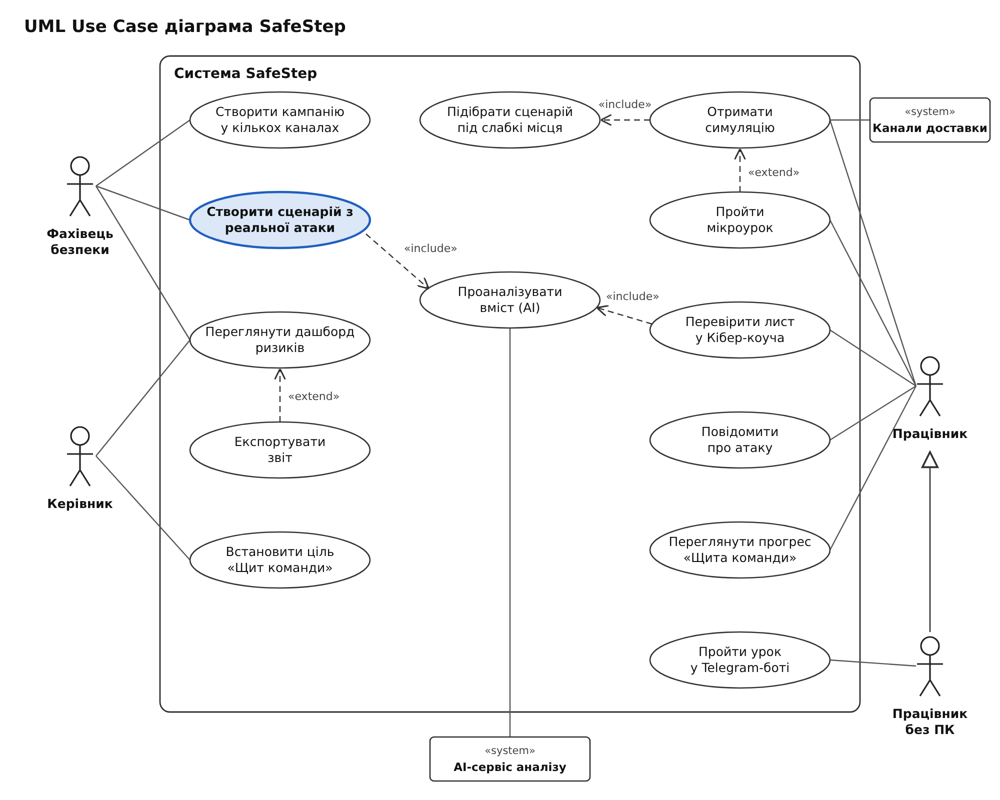
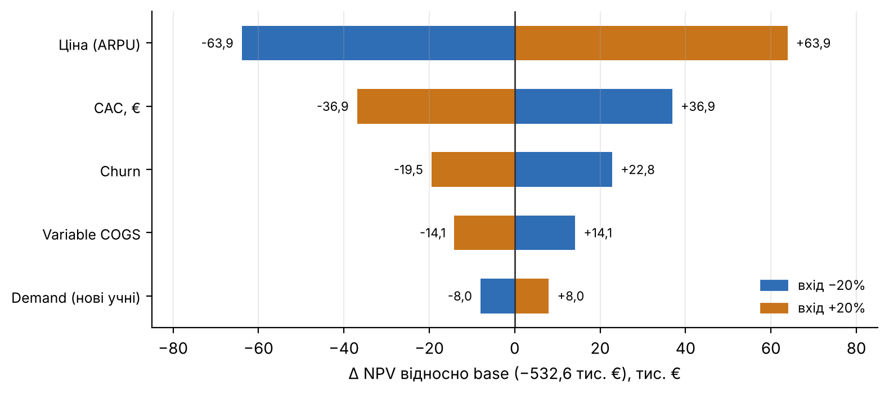

# SafeStep — адаптивний тренажер кібергігієни

**Навчальний case study повного циклу аналізу програмного продукту:** від product vision і вимог через UML-архітектуру до оцінки строку, кошторису, ціноутворення, unit economics, NPV і рішення інвестиційного комітету.

Виконано протягом семестру в межах двох дисциплін у Національному університеті «Київський авіаційний інститут» (2026, варіант 19 — «Тренажер кібербезпеки»).

> 🇬🇧 *A semester-long university case study (in Ukrainian) of a security-awareness training product: product vision, requirements and use cases, UML architecture, effort/schedule estimation (PERT, story points, UCP), TCO, pricing, unit economics, NPV and a final go/no-go business case. A small Python model reproduces the key numbers.*

---

## Продукт

SafeStep безпечно імітує фішингові атаки в тих каналах, де вони трапляються насправді (пошта, SMS, месенджери, QR-коди), одразу після помилки показує короткий мікроурок без осуду і дає організації одну вимірювану метрику поведінки — **repeat-error rate** (частку людей, що помилилися двічі поспіль). Ціль: з 12% до ≤ 5% за 6 місяців.

- **Клієнт:** організація на 300–1000 працівників; первинний сегмент — офісні працівники, які щодня працюють з поштою й рахунками.
- **Обмеження варіанта:** симуляції не мають принижувати чи карати працівників — тому жодних індивідуальних рейтингів, лише агрегати від 10 осіб.
- **Обов'язкова функція варіанта:** офлайн-режим (F10) для працівників без постійного зв'язку.



## Головний результат

Модель показала, що **за поточних умов у проєкт не варто інвестувати** — і саме це є найцікавішим висновком роботи.

| Показник | Значення | Джерело |
|---|---|---|
| Строк MVP (baseline) | 130 робочих днів (26 тижнів), P50 = 122,5 дня | [ЛР 2](docs/software-economics/lr2-size-effort-schedule.md) |
| Cost baseline MVP | 86 572 € | [ЛР 3](docs/software-economics/lr3-cost-estimate-tco.md) |
| Тарифи | Basic 209 € · Standard 649 € · Pro 2 290 € на місяць | [ЛР 4](docs/software-economics/lr4-monetization-pricing.md) |
| ARPU · gross margin | 8,21 € на учня · 72,2% | [ЛР 4](docs/software-economics/lr4-monetization-pricing.md) |
| CAC · LTV/CAC · payback | 40 € · 2,47 · 6,8 міс. | [ЛР 5](docs/software-economics/lr5-unit-economics-break-even.md) |
| Operating break-even | 3 593 учнів — а база стабілізується на 2 833 | [ЛР 5](docs/software-economics/lr5-unit-economics-break-even.md) |
| NPV (12 кварталів, r = 24%) | −532 605 € (усі три сценарії від'ємні) | [ЛР 6](docs/software-economics/lr6-cash-flow-npv.md) |
| **Рішення** | **STOP**; NPV = 0 лише при ARPU ≈ 21,90 € (×2,67) | [ЛР 8](docs/software-economics/lr8-scenarios-business-case.md) |

Чому так: продукт має здорову маржу, але при 170 нових учнях на місяць і відтоку 6% база ніколи не дорівнює операційній точці беззбитковості. Головний драйвер — ціна, а не попит (tornado-аналіз у ЛР 8). Замість «закрити» робота пропонує дешевий 8-тижневий пілот і три decision gates (G1–G3), які покажуть, чи готові клієнти платити потрібну ціну.



## Лабораторні роботи

### «Аналіз вимог до ПЗ» — цільовий продукт

| ЛР | Тема | Що всередині |
|---|---|---|
| 1 | [Product Vision, вимоги та Use Case](docs/requirements-analysis/lr1-vision-requirements-use-case.md) | Vision statement, 5 BR, 5 UR, 10 FR (user stories), 5 NFR, SRS для Real-to-Drill, Use Case діаграма |
| 2 | [Аналіз предметної галузі](docs/requirements-analysis/lr2-domain-and-competitors.md) | Проблема, огляд 5 аналогів (KnowBe4, Hoxhunt, MS Attack Simulation, RansomLeak, Дія.Освіта), порівняльна таблиця |
| 3 | [UML: поведінка й архітектура](docs/requirements-analysis/lr3-uml-behavior-architecture.md) | Діаграми діяльності, послідовності, компонентів (19 компонентів), розгортання |

### «Економіка програмного забезпечення» — MVP

| ЛР | Тема | Ключовий результат |
|---|---|---|
| 1 | [Паспорт продукту й економічна постановка](docs/software-economics/lr1-product-passport.md) | Сегментація, стейкхолдери, межі MVP (F1–F10), реєстр припущень |
| 2 | [Розмір, трудомісткість і строк](docs/software-economics/lr2-size-effort-schedule.md) | WBS, PERT, story points, UCP; baseline 130 днів |
| 3 | [Кошторис і TCO](docs/software-economics/lr3-cost-estimate-tco.md) | Labor за ролями, EMV ризиків, cash burn, TCO cloud vs fixed hosting |
| 4 | [Монетизація й тарифна сітка](docs/software-economics/lr4-monetization-pricing.md) | Hybrid base + usage, floor price, захист маржі від «безлімітних» клієнтів |
| 5 | [Unit economics і break-even](docs/software-economics/lr5-unit-economics-break-even.md) | Воронка, LTV/CAC, прогноз бази, чутливість ±20% |
| 6 | [Грошові потоки й NPV](docs/software-economics/lr6-cash-flow-npv.md) | Квартальний cash flow, NPV/IRR/PP/DPP у трьох сценаріях |
| 7 | [Якість, ризики й технічний борг](docs/software-economics/lr7-quality-risk-tech-debt.md) | Cost of Quality, ROI автоматизації тестів, реєстр 12 ризиків, tech debt |
| 8 | [Сценарний аналіз і захист бізнес-кейсу](docs/software-economics/lr8-scenarios-business-case.md) | Cloud vs on-premise, tornado, roadmap і decision gates, рішення STOP |

Як вимоги цільового продукту (FR1–FR10) співвідносяться з функціями MVP (F1–F10) і які розбіжності між звітами знайдено — у [**docs/traceability.md**](docs/traceability.md).

## Структура репозиторію

```
.
├── README.md
├── docs/
│   ├── requirements-analysis/   # ЛР 1–3 «Аналіз вимог до ПЗ» (Markdown)
│   ├── software-economics/      # ЛР 1–8 «Економіка ПЗ» (Markdown)
│   ├── images/                  # UML-діаграми та графіки
│   └── traceability.md          # FR ↔ F, ланцюг чисел, відомі розбіжності
├── specs/features/              # Gherkin-сценарії для FR4, FR6, FR7, FR10
├── model/safestep_model.py      # відтворювана економічна модель
└── reports/                     # оригінальні звіти (.docx / .pdf) без змін
```

## Відтворювана модель

[`model/safestep_model.py`](model/safestep_model.py) з нуля перераховує критичний шлях PERT, UCP, тарифну маржу, unit economics і NPV і звіряє результат зі звітами. Потрібен лише Python 3.9+:

```bash
python model/safestep_model.py
```

```
ЛР 2 — строк і трудомісткість
  OK  Критичний шлях μ, роб. дні             модель         122.50   звіт         122.50
  ...
ЛР 6 — NPV (r = 24%, 12 кварталів)
  OK  NPV Base, €                            модель    -532,605.16   звіт    -532,605.00
  ..  NPV = 0 при ARPU ≈ 21.90 € (×2.67)  — у звіті ЛР 8: 21,90 € (×2,67)

22/22 показників збігаються зі звітами
```

## Gherkin-специфікації

У [`specs/features/`](specs/features/) — приймальні сценарії українською (`# language: uk`) для чотирьох ключових вимог: повідомлення про атаку (FR4), Кібер-коуч (FR6), Real-to-Drill (FR7) та офлайн-режим (FR10). Вони побудовані на критеріях приймання з ЛР 1 і сумісні з Cucumber / behave.

## Автор

**Маргарита Смаль**, кафедра інженерії програмного забезпечення, НУ «Київський авіаційний інститут», 2026.

Дані про конкурентів і статистику атак у ЛР 2 «Аналізу вимог» зібрано з відкритих джерел (список — наприкінці звіту). Фінансові показники — навчальні припущення, а не ринкові факти.
