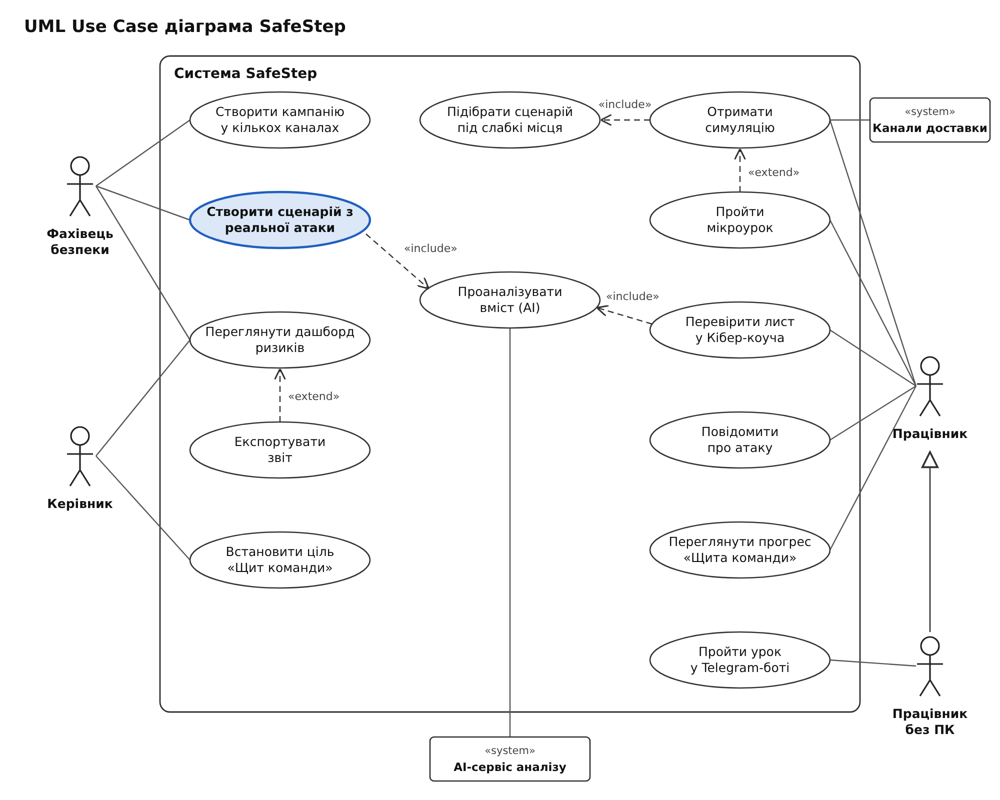

# ЛР 1. Product Vision, вимоги до ПЗ та Use Case

> Дисципліна: «Аналіз вимог до ПЗ» · Продукт: SafeStep (варіант 19) · КАІ, 2026  
> Оригінал звіту: [`lr1-vision-requirements-use-case.docx`](../../reports/requirements-analysis/lr1-vision-requirements-use-case.docx)

## Вихідні дані

**Мета роботи:** навчитися формулювати бачення продукту та різні рівні вимог (бізнес, користувацькі, функціональні, нефункціональні), описувати функціональні вимоги у форматі User Story та Gherkin, специфікувати Use Case у форматі SRS і будувати UML Use Case діаграму.

**Обраний продукт:** SafeStep — власний продукт. Це адаптивний тренажер кібергігієни для працівників організацій на 300–1000 осіб. Він безпечно імітує атаки в тих каналах, де вони реально трапляються (пошта, SMS, месенджери, QR-коди), підлаштовує складність під кожну людину, перетворює реальні атаки на тренування і щодня допомагає перевіряти підозрілі повідомлення.

**Ролі (актори):** Працівник, Працівник без ПК (склад, виробництво, поле), Фахівець безпеки, Керівник організації, а також зовнішні системи «Канали доставки» (пошта, SMS, Telegram) і «AI-сервіс аналізу».

## 1. Product Vision

SafeStep існує, щоб кібергігієна стала щоденною звичкою працівника, а не щорічним курсом «для галочки», і щоб організація бачила, як змінюється поведінка людей.

### 1.1. Відповіді на ключові питання

**Таблиця 1. Питання для формування Product Vision**

| Питання                      | Відповідь для SafeStep                                                                                                                                                                                        |
|----------------------------------|-------------------------------------------------------------------------------------------------------------------------------------------------------------------------------------------------------------------|
| Яке перше враження від продукту? | «Особистий тренер з кібербезпеки»: короткі тренування під мої слабкі місця і помічник, якому можна показати будь-який підозрілий лист чи SMS.                                                                     |
| Що людям потрібно від продукту?  | Працівнику — коротке навчання без осуду та швидка відповідь «це шахрайство чи ні?». Фахівцю безпеки — актуальні сценарії без ручної роботи і єдина метрика. Керівнику — зрозумілий рівень ризику за підрозділами. |
| Скільки людей мають цю проблему? | Усі організації з корпоративною поштою та мобільними працівниками. Атаки дедалі частіше йдуть не лише поштою, а й через SMS, Telegram, Viber і QR-коди, а навчання зазвичай покриває лише email.                  |
| Де продукт на ринку?             | Між LMS-курсами (навчання без вимірювання поведінки) і фішинг-платформами (вимірювання без навчання, лише email). SafeStep поєднує навчання, вимірювання і щоденну допомогу в усіх каналах.                       |
| Чи існує технологія?             | Так: вебзастосунок і PWA, SSO (SAML / OpenID Connect), SMTP та SMS-шлюзи, Telegram Bot API, великі мовні моделі для аналізу тексту і знеособлення даних.                                                          |
| Хто ідеальний клієнт?            | Фахівець безпеки в організації на 300–1000 осіб, де частина персоналу працює без ПК. Платник — керівник організації.                                                                                              |
| Чому оберуть саме це рішення?    | Мультиканальні симуляції, адаптивна складність, перетворення реальної атаки на тренування за 10 хв, Кібер-коуч для щоденних перевірок і етична модель без покарань.                                               |

### 1.2. Product Vision Statement

**Таблиця 2. Product Vision Statement**

| Елемент               | Зміст                                                                                                                                                     |
|---------------------------|---------------------------------------------------------------------------------------------------------------------------------------------------------------|
| For (для кого)            | працівників і фахівців з інформаційної безпеки середніх організацій (300–1000 осіб)                                                                           |
| Who (що потребують)       | стикаються з шахрайством не лише в пошті, а й у SMS, месенджерах і QR-кодах, але проходять лише формальний щорічний курс і не можуть виміряти зміну поведінки |
| The (назва)               | SafeStep                                                                                                                                                      |
| Is a (категорія)          | адаптивний тренажер кібергігієни з безпечними мультиканальними симуляціями та AI-помічником                                                                   |
| That (ключова цінність)   | тренує кожну людину на її слабких місцях, за 3 хв пояснює помилку, за 30 с перевіряє підозріле повідомлення і показує організації єдину метрику ризику        |
| Unlike (на відміну від)   | щорічного курсу в LMS та фішинг-платформ, що тестують лише email і однакові для всіх                                                                          |
| Our product (відмінність) | працює в усіх каналах атак, перетворює реальні атаки на тренування, стимулює командну, а не індивідуальну відповідальність і нікого не карає                  |

**Висловлювання цілісно:** Для працівників і фахівців безпеки середніх організацій, які стикаються з шахрайством у пошті, SMS, месенджерах і QR-кодах, SafeStep — це адаптивний тренажер кібергігієни, який тренує кожного на його слабких місцях і щодня допомагає перевіряти підозрілі повідомлення. На відміну від LMS-курсів і фішинг-платформ, наш продукт охоплює всі канали атак, вчиться на реальних атаках і не карає за помилки.

### 1.3. Ключові можливості продукту

- **Мультиканальні симуляції** — тренування в пошті, SMS, Telegram/Viber та через QR-коди на офісних постерах.

- **Адаптивна траєкторія** — система підбирає наступний сценарій під тип атак, на яких людина помиляється.

- **Real-to-Drill** — реальна атака, про яку повідомив працівник, за 10 хв стає знеособленим тренувальним сценарієм для всіх.

- **Кібер-коуч** — працівник пересилає будь-яке підозріле повідомлення (зокрема з особистого телефона) і за 30 с отримує пояснення ознак.

- **«Щит команди»** — спільна ціль відділу (наприклад, 90% атак повідомлено) замість індивідуальних рейтингів і порівняння людей.

- **Telegram-бот і офлайн-режим** — навчання для працівників без ПК.

**Ключова метрика успіху:** repeat-error rate (частка працівників, що помилилися у двох симуляціях поспіль) знижується з 12% до ≤ 5% за 6 місяців; медіанний час повідомлення про атаку скорочується до ≤ 15 хв.

## 2. Бізнес-вимоги та вимоги користувача

### 2.1. Бізнес-вимоги (Business Requirements)

**Таблиця 3. Бізнес-вимоги**

| ID | Бізнес-вимога                                                                                  | Метрика успіху                                                                              |
|--------|----------------------------------------------------------------------------------------------------|-------------------------------------------------------------------------------------------------|
| BR1    | Знизити ризик інцидентів через соціальну інженерію, зменшивши частку повторних помилок працівників | Repeat-error rate з 12% до ≤ 5% за 6 міс.                                                       |
| BR2    | Скоротити час реакції організації на реальні атаки завдяки швидким повідомленням працівників       | Медіанний time-to-report з ~4 год до ≤ 15 хв                                                    |
| BR3    | Скоротити ручну роботу фахівця безпеки зі звітами та підготовки нових сценаріїв                    | Квартальний звіт з ~16 год до ≤ 1 год; новий сценарій з реальної атаки ≤ 10 хв замість 1–2 днів |
| BR4    | Охопити навчанням усі канали атак і весь персонал, зокрема працівників без ПК                      | ≥ 4 канали симуляцій; ≥ 70% працівників без ПК проходять ≥ 1 тренування на місяць               |
| BR5    | Забезпечити етичне навчання без покарання та відповідність законодавству про персональні дані      | 0 дисциплінарних випадків через симуляції; ≥ 80% позитивних оцінок в анонімному опитуванні      |

### 2.2. Вимоги користувача (User Requirements)

**Таблиця 4. Вимоги користувача**

| ID | Вимога користувача                                                                                                                                                                  | Пов’язана BR |
|--------|-----------------------------------------------------------------------------------------------------------------------------------------------------------------------------------------|------------------|
| UR1    | Як фахівець безпеки, я хочу за кілька хвилин перетворювати реальну атаку, про яку повідомили працівники, на безпечний тренувальний сценарій, щоб тренувати людей на актуальних загрозах | BR2, BR3         |
| UR2    | Як працівник, я хочу отримувати тренування саме на тих типах атак, де я помиляюся, і короткий розбір після помилки, щоб швидше навчитися і не відчувати осуду                           | BR1, BR5         |
| UR3    | Як працівник, я хочу показати підозріле повідомлення Кібер-коучу й одразу дізнатися, чи це шахрайство, щоб не ризикувати і не чекати відповіді фахівця                                  | BR1, BR2         |
| UR4    | Як керівник організації, я хочу бачити рівень ризику за підрозділами та каналами і ставити командам спільні цілі, щоб керувати ризиком без покарання окремих людей                      | BR3, BR5         |
| UR5    | Як працівник без ПК, я хочу проходити тренування в Telegram-боті на телефоні, навіть зі слабким зв’язком, щоб навчатися нарівні з офісними колегами                                     | BR4              |

## 3. Функціональні вимоги

> 💡 Gherkin-сценарії для FR4, FR6, FR7 і FR10 винесено в окремі файли: [`specs/features/`](../../specs/features/). Як FR співвідносяться з функціями MVP F1–F10 — у [`traceability.md`](../traceability.md).

### FR1. \[Фахівець безпеки\]\[Desktop\] Мультиканальна кампанія

**As a** фахівець безпеки **I want** створити кампанію-симуляцію, обравши шаблон, канали доставки, групу працівників і розклад **so that** тренувати людей у тих каналах, де атаки трапляються насправді.

**Acceptance criteria:**

1.  Доступні канали: email, SMS, Telegram, Viber, QR-постер (генерується PDF для друку з унікальним QR-кодом).

2.  Одна кампанія може використовувати 1–3 канали; для кожного каналу показується попередній перегляд повідомлення.

3.  Отримувачі обираються з груп SSO або імпортуються з CSV; мінімальний розмір групи — 10 осіб.

4.  Тривалість кампанії — від 1 до 14 днів; дата старту не може бути в минулому.

5.  Після збереження кампанія отримує статус «Запланована».

### FR2. \[Система\] Адаптивна траєкторія навчання

**As a** працівник **I want** щоб наступна симуляція підбиралася під типи атак, на яких я помиляюся **so that** тренуватися там, де я найвразливіший, і не витрачати час на те, що вже вмію.

**Acceptance criteria:**

1.  Для кожного працівника ведеться профіль за 5 типами атак (підроблений рахунок, запит пароля, небезпечне вкладення, фальшива доставка, «служба безпеки банку»).

2.  З імовірністю 60% наступна симуляція береться з типу з найгіршим результатом, 40% — з інших типів.

3.  Після 3 правильних реакцій поспіль рівень складності для цього типу зростає (1 → 2 → 3).

4.  Профіль бачить лише сам працівник; фахівець і керівник бачать тільки агреговані дані.

### FR3. \[Працівник\]\[Desktop/Mobile\] Мікроурок після помилки

**As a** працівник **I want** одразу після помилки в симуляції побачити короткий інтерактивний розбір **so that** зрозуміти, які ознаки атаки я пропустив.

**Acceptance criteria:**

1.  Мікроурок відкривається за ≤ 2 с після помилки (перехід за посиланням, введення даних, сканування QR).

2.  Працівник сам шукає та натискає 2–4 ознаки атаки на скріншоті повідомлення, після чого бачить пояснення до кожної.

3.  Урок триває ≤ 3 хв; текст не містить слів «провалили», «винні», «покарання».

4.  Урок можна закрити в будь-який момент; він залишається доступним у розділі «Мої уроки».

### FR4. \[Працівник\]\[Пошта/Telegram\] Повідомлення про атаку

**As a** працівник **I want** повідомити про підозріле повідомлення однією кнопкою **so that** захистити колег і одразу дізнатися, чи вчинив правильно.

**Acceptance criteria:**

1.  Кнопка «Повідомити» доступна в Outlook, Gmail і в Telegram-боті (пересилання повідомлення боту).

2.  Якщо це була симуляція, працівник бачить «Дякуємо! Це було тренування, ви вчинили правильно».

3.  Якщо повідомлення справжнє, воно потрапляє в чергу «Повідомлені атаки» фахівця безпеки.

4.  Система фіксує time-to-report (час від доставки до повідомлення) з точністю до 1 с.

### FR5. \[Фахівець безпеки\]\[Desktop\] Черга повідомлених атак

**As a** фахівець безпеки **I want** бачити всі повідомлені працівниками реальні атаки в одній черзі, згруповані за схожістю **so that** швидко реагувати на масову атаку, а не розбирати десятки однакових листів.

**Acceptance criteria:**

1.  Схожі повідомлення (той самий відправник, домен або посилання) групуються в одну картку з лічильником.

2.  Картка показує канал, перший і останній час повідомлення, кількість працівників.

3.  Фахівець може позначити картку як «Підтверджена атака», «Безпечне» або «Спам».

4.  Нова група з ≥ 5 повідомлень за 10 хв надсилає фахівцю push-сповіщення.

### FR6. \[Працівник\]\[Desktop/Mobile\] Кібер-коуч

**As a** працівник **I want** надіслати Кібер-коучу будь-яке підозріле повідомлення, зокрема скріншот з особистого телефона **so that** за пів хвилини дізнатися, чи це шахрайство і чому.

**Acceptance criteria:**

1.  Повідомлення можна передати текстом, пересиланням листа або скріншотом (PNG/JPG до 5 МБ) у вебзастосунку чи Telegram-боті.

2.  Відповідь містить вердикт («Схоже на шахрайство» / «Ознак шахрайства не знайдено» / «Не впевнений — передано фахівцю») і 1–5 знайдених ознак.

3.  95% відповідей надаються за ≤ 30 с.

4.  Повідомлення не зберігається довше ніж 24 год і не потрапляє в профіль працівника.

### FR7. \[Фахівець безпеки\]\[Desktop\] Real-to-Drill: сценарій з реальної атаки

**As a** фахівець безпеки **I want** перетворити підтверджену реальну атаку на безпечний тренувальний сценарій **so that** за кілька хвилин тренувати всіх працівників на загрозі, яка вже атакує організацію.

**Acceptance criteria:**

1.  Кнопка «Створити тренування» доступна для картки зі статусом «Підтверджена атака».

2.  AI-сервіс замінює всі посилання на безпечні, видаляє персональні дані та вкладення і позначає 2–5 ознак атаки.

3.  Фахівець бачить порівняння «оригінал / тренувальна версія» і може відредагувати текст.

4.  Шаблон зберігається в каталозі за ≤ 10 хв від натискання кнопки. Детальний опис — у розділі 5 (SRS).

### FR8. \[Керівник, Працівник\]\[Desktop/Mobile\] «Щит команди»

**As a** керівник організації **I want** встановлювати підрозділам спільну ціль з кібергігієни і показувати команді її прогрес **so that** люди допомагали одне одному, а не змагалися і не боялися рейтингів.

**Acceptance criteria:**

1.  Ціль задається для підрозділу від 10 осіб: метрика (report rate або repeat-error rate), значення і термін (1–3 місяці).

2.  Працівники бачать прогрес команди у вигляді шкали «Щит» (0–100%) без імен і без індивідуальних місць.

3.  Після досягнення цілі всі учасники отримують сповіщення та цифровий значок команди.

4.  Індивідуальні рейтинги та «дошки ганьби» в системі відсутні.

### FR9. \[Фахівець безпеки, Керівник\]\[Desktop\] Дашборд ризиків і експорт звіту

**As a** фахівець безпеки **I want** бачити рівень ризику за підрозділами, каналами та типами атак і експортувати звіт **so that** показати керівництву ефект навчання без ручного зведення даних.

**Acceptance criteria:**

1.  Дашборд показує click rate, report rate, repeat-error rate і медіанний time-to-report з динамікою за 6 кампаній.

2.  Дані можна розрізати за підрозділом, каналом (email / SMS / месенджер / QR) і типом атаки.

3.  Групи менше 10 осіб не відображаються; імен працівників у звітах для керівника немає.

4.  Експорт у PDF або CSV виконується за ≤ 3 кліки і ≤ 30 с.

### FR10. \[Працівник без ПК\]\[Mobile\] Навчання в Telegram-боті з офлайн-режимом

**As a** працівник без ПК **I want** проходити мікроуроки в Telegram-боті та в PWA без стабільного інтернету **so that** навчатися з телефона під час зміни, а мій прогрес не губився.

**Acceptance criteria:**

1.  Бот прив’язується до корпоративного акаунта через одноразовий код із SSO.

2.  Бот надсилає не більше 2 тренувань на тиждень і лише в робочий час працівника.

3.  У PWA зберігаються 3 останні мікроуроки; без мережі вони відкриваються за ≤ 3 с.

4.  Результати офлайн-уроків синхронізуються за ≤ 5 хв після відновлення мережі без втрат і дублікатів.

## 4. Нефункціональні вимоги

**Таблиця 5. Нефункціональні вимоги**

| ID | Категорія                                            | Вимога                                                                                                                                                                                                                                                                                            |
|--------|----------------------------------------------------------|-------------------------------------------------------------------------------------------------------------------------------------------------------------------------------------------------------------------------------------------------------------------------------------------------------|
| NFR1   | Performance (продуктивність)                             | 95% запитів до дашборду мають час відповіді ≤ 2 с при 1000 одночасних користувачів (Chrome desktop, LTE); 95% відповідей Кібер-коуча — ≤ 30 с.                                                                                                                                                        |
| NFR2   | Availability (доступність)                               | Сервіс доступний ≥ 99,5% часу щомісяця (простій ≤ 3,6 год); MTTR ≤ 30 хв. Якщо AI-сервіс недоступний, система переходить у ручний режим без втрати даних.                                                                                                                                             |
| NFR3   | Security & Privacy (безпека та приватність)              | TLS 1.2+ для передачі даних, AES-256 у сховищі; дані зберігаються в ЄС; вміст клієнтів не використовується для навчання AI-моделей; 100% персональних даних видаляються під час Real-to-Drill (перевірка на тестовому наборі з 200 листів); відповідність ЗУ «Про захист персональних даних» та GDPR. |
| NFR4   | Ethics & Usability (етичність і зручність)               | ≤ 2 симуляції на людину на місяць; 0 шаблонів з образливим чи залякувальним текстом (перевірка двома рецензентами); ≥ 90% працівників завершують мікроурок без допомоги за ≤ 3 хв; інтерфейс відповідає WCAG 2.1 рівня AA.                                                                            |
| NFR5   | Localization & Compatibility (локалізація та сумісність) | Мова за замовчуванням — українська, ручний перемикач — англійська. Підтримуються останні 2 версії Chrome, Edge, Firefox, Safari; Android 11+ і iOS 15+ (PWA); надбудови Outlook і Gmail; Telegram Bot API.                                                                                            |

## 5. Специфікація Use Case «Створити сценарій з реальної атаки» (SRS)

Специфікація описує функціональну вимогу FR7 (Real-to-Drill).

**1. Короткий опис.** Фахівець безпеки перетворює реальну атаку, про яку повідомили працівники, на безпечний тренувальний сценарій. Система через AI-сервіс знеособлює вміст і замінює небезпечні елементи, фахівець перевіряє результат, після чого шаблон зберігається в каталозі й стає доступним для кампаній.

**2. Суб’єкт (актор).** Фахівець безпеки. Допоміжний актор — AI-сервіс аналізу.

**3. Передумови.**

- Система працює коректно.

- Фахівець безпеки увійшов через SSO і має роль «Фахівець безпеки». Функція доступна лише в desktop-версії.

- У черзі «Повідомлені атаки» є картка зі статусом «Підтверджена атака» (FR5).

- Фахівець відкрив картку атаки.

- Вікно створення має поля «Назва шаблону», «Канал», «Рівень складності (1–3)», «Тип атаки», блок порівняння «Оригінал / Тренувальна версія», текст мікроуроку та кнопки «Відмінити» і «Зберегти шаблон».

**4. Основний потік (Base flow).**

1.  Натиснути кнопку «Створити тренування» на картці атаки.

2.  Система надсилає вміст повідомлення до AI-сервісу аналізу, який:

    1.  замінює всі посилання на безпечні посилання SafeStep;

    2.  видаляє персональні дані (імена, телефони, email, номери рахунків і карток) та замінює їх вигаданими;

    3.  видаляє вкладення та замінює їх безпечним файлом-муляжем;

    4.  позначає 2–5 ознак атаки та формує чернетку мікроуроку.

3.  Система перевіряє результат контрольним фільтром персональних даних і показує порівняння «Оригінал / Тренувальна версія» з підсвіченими змінами.

4.  Перевірити та за потреби відредагувати тренувальну версію і мікроурок.

5.  Заповнити поля: назва шаблону (3–60 символів), канал, рівень складності, тип атаки.

6.  Натиснути кнопку «Зберегти шаблон».

    1.  Якщо обов’язкові поля не заповнені — перехід A1.

    2.  Якщо контрольний фільтр знайшов персональні дані — перехід A2.

    3.  Якщо в тексті залишилося оригінальне посилання — перехід A3.

    4.  Якщо сервер не може зберегти шаблон — перехід A4.

7.  Система зберігає шаблон зі статусом «Активний» і позначкою «Реальна атака», показує повідомлення «Шаблон створено» і пропонує одразу запустити кампанію (FR1).

8.  За потреби скасувати створення кнопкою «Відмінити»: чернетка не зберігається, картка атаки не змінюється.

**5. Альтернативні потоки.**

**A1. Неповна інформація.** Якщо є порожні обов’язкові поля, система підсвічує їх червоним і показує «Заповніть обов’язкові поля». Повернення до кроку 5.

**A2. Залишилися персональні дані.** Якщо фільтр знайшов ім’я, телефон, email або номер рахунку, система підсвічує фрагмент і показує «Видаліть або замініть персональні дані перед збереженням». Збереження заблоковано. Повернення до кроку 4.

**A3. Небезпечне посилання.** Якщо в тексті знайдено оригінальне посилання або домен, система замінює його безпечним і показує «Оригінальне посилання замінено». Повернення до кроку 4.

**A4. Помилка сервера.** Якщо шаблон не зберігся в базі даних, система показує «Помилка збереження. Спробуйте ще раз», зберігає чернетку локально та дозволяє повторити збереження.

**6. Постумови.** Шаблон з позначкою «Реальна атака» доступний у каталозі; картка атаки отримує позначку «Тренування створено»; працівники, які повідомили про атаку, отримують анонімну подяку «Ваше повідомлення допомогло захистити колег».

## 6. UML діаграма

*Рисунок 1. UML Use Case діаграма програмного продукту SafeStep*

Зліва розташовані актори «Фахівець безпеки» і «Керівник», справа — «Працівник» і «Працівник без ПК», який успадковує всі можливості працівника (зв’язок узагальнення) і додатково проходить уроки в Telegram-боті. Зовнішні системи — «Канали доставки» та «AI-сервіс аналізу». Виділено варіант використання «Створити сценарій з реальної атаки», специфікований у розділі 5.

Зв’язки «include» показують обов’язкове включення поведінки: отримання симуляції завжди включає підбір сценарію під слабкі місця, а створення сценарію з реальної атаки та перевірка листа в Кібер-коуча включають аналіз вмісту AI-сервісом. Зв’язки «extend» показують необов’язкове розширення: мікроурок відкривається лише після помилки, експорт звіту — лише на вимогу.

## Висновки

У роботі для власного продукту SafeStep сформовано Product Vision адаптивного тренажера кібергігієни. Продукт поєднує мультиканальні симуляції, адаптивне навчання, перетворення реальних атак на тренування, AI-помічника для щоденних перевірок і командні цілі замість індивідуальних рейтингів.

Вимоги побудовано зверху вниз: 5 бізнес-вимог з вимірюваними метриками, 5 вимог користувача з прив’язкою до них, 10 функціональних вимог у форматі User Story з Acceptance Criteria (чотири — з Gherkin-сценаріями) та 5 нефункціональних вимог із числовими критеріями, зокрема щодо приватності та етичності.

Для найбільш інноваційної вимоги FR7 «Real-to-Drill» описано Use Case у форматі SRS з основним і 5 альтернативними потоками. UML Use Case діаграма показує 4 актори-людини (з узагальненням «Працівник без ПК» → «Працівник»), 2 зовнішні системи та 13 варіантів використання зі зв’язками «include» і «extend».
