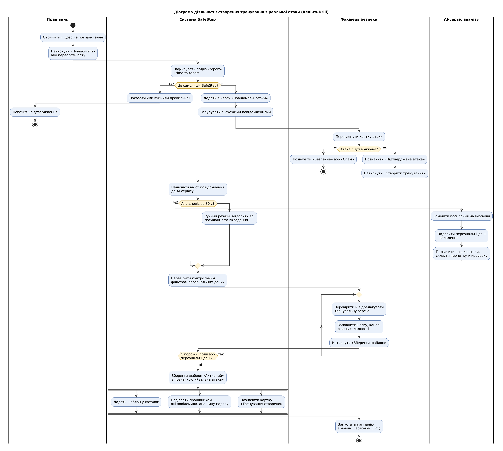
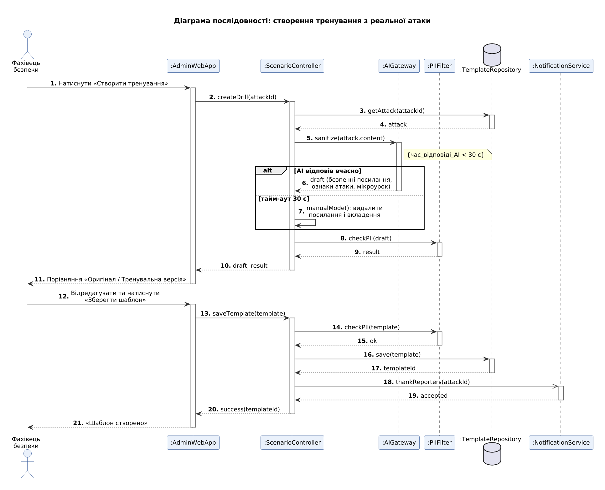
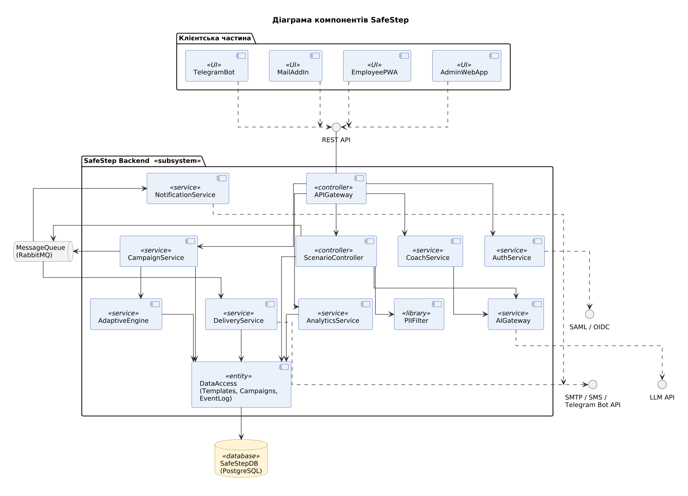
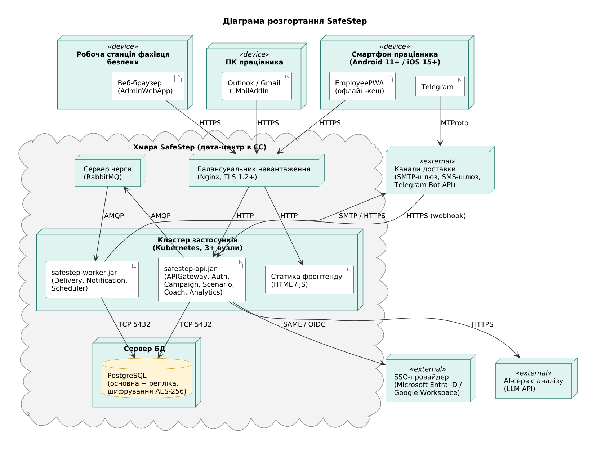

# ЛР 3. Моделювання поведінки ПЗ. Проєктування архітектури

> Дисципліна: «Аналіз вимог до ПЗ» · Продукт: SafeStep (варіант 19) · КАІ, 2026  
> Оригінал звіту: [`lr3-uml-behavior-architecture.docx`](../../reports/requirements-analysis/lr3-uml-behavior-architecture.docx)

Мета роботи:** дослідження діаграм UML, які застосовуються для опису поведінки програмного забезпечення та його архітектури, і отримання навичок їх побудови.

**Об’єкт моделювання:** програмний засіб SafeStep — адаптивний тренажер кібергігієни. Діаграми діяльності та послідовності побудовано для ключового варіанту використання «Створити сценарій з реальної атаки» (Real-to-Drill, функціональна вимога FR7), специфікованого у форматі SRS в лабораторній роботі № 1.

**Завдання:**

1.  Побудувати діаграми діяльності та послідовності для свого варіанту.

2.  Побудувати діаграму компонентів для свого варіанту.

3.  Побудувати діаграму розгортання.

## 1. Діаграма діяльності

Діаграма діяльності описує повний бізнес-процес Real-to-Drill: від моменту, коли працівник отримав підозріле повідомлення, до запуску тренувальної кампанії з новим шаблоном. Дії згруповано у 4 доріжки (swimlanes) за виконавцями: «Працівник», «Система SafeStep», «Фахівець безпеки» та «AI-сервіс аналізу».

Діаграму наведено на наступній сторінці (рисунок 1).

*Рисунок 1. Діаграма діяльності «Створення тренування з реальної атаки»*

**Опис процесу:**

1.  Працівник отримує підозріле повідомлення і повідомляє про нього кнопкою «Повідомити» в поштовому клієнті або пересилає його Telegram-боту.

2.  Система фіксує подію «report» і час реакції (time-to-report). Якщо це була тренувальна симуляція SafeStep, працівник одразу бачить підтвердження «Ви вчинили правильно», і процес завершується.

3.  Якщо повідомлення справжнє, система додає його в чергу «Повідомлені атаки» та групує зі схожими повідомленнями.

4.  Фахівець безпеки переглядає картку атаки. Якщо атаку не підтверджено, картка позначається як «Безпечне» або «Спам», і процес завершується.

5.  Для підтвердженої атаки фахівець натискає «Створити тренування». Система надсилає вміст до AI-сервісу аналізу.

6.  Якщо AI-сервіс відповів протягом 30 с, він замінює посилання на безпечні, видаляє персональні дані й вкладення, позначає ознаки атаки та складає чернетку мікроуроку. Інакше система переходить у ручний режим і видаляє всі посилання та вкладення автоматично.

7.  Обидві гілки об’єднуються, після чого система перевіряє результат контрольним фільтром персональних даних.

8.  Фахівець редагує тренувальну версію, заповнює поля й натискає «Зберегти шаблон». Цикл повторюється, доки не залишиться порожніх полів і персональних даних.

9.  Після збереження шаблону система паралельно (fork / join) виконує три дії: додає шаблон у каталог, надсилає працівникам, які повідомили про атаку, анонімну подяку та позначає картку «Тренування створено».

10. Фахівець запускає кампанію з новим шаблоном (функціональна вимога FR1).

## 2. Діаграма послідовності

Діаграма послідовності деталізує технічну частину того ж процесу: які об’єкти системи обмінюються повідомленнями і в якому порядку, коли фахівець безпеки створює тренування з підтвердженої атаки.

*Рисунок 2. Діаграма послідовності «Створення тренування з реальної атаки»*

**Учасники взаємодії:**

**Таблиця 2. Об’єкти діаграми послідовності**

| Об’єкт           | Роль                                                           |
|----------------------|--------------------------------------------------------------------|
| Фахівець безпеки     | Актор, що ініціює створення тренування.                            |
| :AdminWebApp         | Вебінтерфейс фахівця безпеки.                                      |
| :ScenarioController  | Контролер, що керує створенням сценарію та координує інші об’єкти. |
| :AIGateway           | Шлюз до зовнішнього AI-сервісу аналізу, що знеособлює вміст.       |
| :PIIFilter           | Бібліотека контрольної перевірки персональних даних.               |
| :TemplateRepository  | Сховище атак і шаблонів у базі даних.                              |
| :NotificationService | Сервіс сповіщень, що надсилає подяку працівникам.                  |

**Опис взаємодії.** Фахівець натискає «Створити тренування» (1). Вебінтерфейс викликає createDrill (2), контролер отримує атаку з репозиторію (3–4) і передає її вміст AI-шлюзу (5). На виклик накладено часове обмеження {час_відповіді_AI \< 30 с}. Комбінований фрагмент **alt** показує дві альтернативи: AI повертає чернетку вчасно (6) або після тайм-ауту контролер сам переходить у ручний режим (7). Далі чернетку перевіряє фільтр персональних даних (8–9), і фахівець бачить порівняння версій (10–11).

Після редагування фахівець зберігає шаблон (12–13). Контролер повторно перевіряє персональні дані (14–15), зберігає шаблон (16–17) і надсилає асинхронне повідомлення thankReporters сервісу сповіщень (18–19). Асинхронність позначено відкритою стрілкою: контролер не чекає, доки всі подяки будуть доставлені. Насамкінець фахівець отримує повідомлення «Шаблон створено» (20–21).

## 3. Діаграма компонентів

Діаграма компонентів показує фізичну структуру SafeStep: з яких програмних модулів складається система, які стереотипи вони мають і через які інтерфейси взаємодіють між собою та із зовнішніми системами.

*Рисунок 3. Діаграма компонентів SafeStep*

**Таблиця 3. Компоненти SafeStep**

| Компонент       | Стереотип      | Призначення                                                           |
|---------------------|--------------------|---------------------------------------------------------------------------|
| AdminWebApp         | \<\<UI\>\>         | Вебінтерфейс фахівця безпеки та керівника: кампанії, черга атак, дашборд. |
| EmployeePWA         | \<\<UI\>\>         | Мобільний вебзастосунок працівника з офлайн-кешем мікроуроків.            |
| MailAddIn           | \<\<UI\>\>         | Надбудова Outlook / Gmail з кнопкою «Повідомити».                         |
| TelegramBot         | \<\<UI\>\>         | Бот для працівників без ПК і для Кібер-коуча.                             |
| SafeStep Backend    | \<\<subsystem\>\>  | Серверна підсистема, що об’єднує всі сервіси бізнес-логіки.               |
| APIGateway          | \<\<controller\>\> | Єдина точка входу REST API: маршрутизація запитів, перевірка токенів.     |
| AuthService         | \<\<service\>\>    | Автентифікація через SSO-провайдера (SAML / OIDC) і ролі користувачів.    |
| CampaignService     | \<\<service\>\>    | Створення та планування мультиканальних кампаній (FR1).                   |
| AdaptiveEngine      | \<\<service\>\>    | Підбір наступного сценарію під слабкі місця працівника (FR2).             |
| ScenarioController  | \<\<controller\>\> | Черга атак і створення тренувань з реальних атак (FR5, FR7).              |
| CoachService        | \<\<service\>\>    | Кібер-коуч — перевірка підозрілих повідомлень працівників (FR6).          |
| AIGateway           | \<\<service\>\>    | Єдиний шлюз до зовнішнього AI-сервісу (LLM API).                          |
| PIIFilter           | \<\<library\>\>    | Бібліотека пошуку персональних даних (імена, телефони, email, IBAN).      |
| AnalyticsService    | \<\<service\>\>    | Розрахунок метрик, дашборд ризиків і експорт звітів (FR9).                |
| DeliveryService     | \<\<service\>\>    | Доставка симуляцій через email, SMS і Telegram.                           |
| NotificationService | \<\<service\>\>    | Сповіщення, подяки та push-повідомлення.                                  |
| DataAccess          | \<\<entity\>\>     | Доступ до бізнес-даних: шаблони, кампанії, журнал подій.                  |
| MessageQueue        | \<\<component\>\>  | Черга повідомлень (RabbitMQ) для асинхронної доставки.                    |
| SafeStepDB          | \<\<database\>\>   | Реляційна база даних PostgreSQL.                                          |

**Інтерфейси.** Клієнтські компоненти звертаються до бекенду лише через інтерфейс REST API (позначено «льодяником»). Бекенд залежить від трьох зовнішніх інтерфейсів: SAML / OIDC (SSO-провайдер), LLM API (AI-сервіс) та SMTP / SMS / Telegram Bot API (канали доставки). Доставка винесена в окремі сервіси, з’єднані через чергу повідомлень. Тому масова розсилка на 1000 отримувачів не сповільнює роботу інтерфейсу (NFR1).

## 4. Діаграма розгортання

Діаграма розгортання показує, на яких фізичних вузлах працюють компоненти SafeStep і якими каналами зв’язку ці вузли з’єднані.

*Рисунок 4. Діаграма розгортання SafeStep*

**Таблиця 4. Вузли діаграми розгортання**

| Вузол                                     | Розгорнуті артефакти                                 | Зв’язки                                           |
|-----------------------------------------------|----------------------------------------------------------|-------------------------------------------------------|
| Робоча станція фахівця безпеки \<\<device\>\> | Веббраузер з AdminWebApp                                 | HTTPS → балансувальник                                |
| ПК працівника \<\<device\>\>                  | Outlook / Gmail з MailAddIn                              | HTTPS → балансувальник                                |
| Смартфон працівника \<\<device\>\>            | EmployeePWA (офлайн-кеш), Telegram                       | HTTPS → балансувальник; MTProto → Telegram            |
| Балансувальник навантаження (Nginx)           | Термінування TLS 1.2+, розподіл запитів                  | HTTP → кластер застосунків                            |
| Кластер застосунків (Kubernetes, 3+ вузли)    | safestep-api.jar, safestep-worker.jar, статика фронтенду | TCP 5432 → БД; AMQP ↔ черга; HTTPS → зовнішні сервіси |
| Сервер черги                                  | RabbitMQ                                                 | AMQP ↔ кластер застосунків                            |
| Сервер БД                                     | PostgreSQL (основна + репліка, шифрування AES-256)       | TCP 5432                                              |
| SSO-провайдер \<\<external\>\>                | Microsoft Entra ID / Google Workspace                    | SAML / OIDC                                           |
| AI-сервіс аналізу \<\<external\>\>            | LLM API                                                  | HTTPS                                                 |
| Канали доставки \<\<external\>\>              | SMTP-шлюз, SMS-шлюз, Telegram Bot API                    | SMTP / HTTPS; HTTPS-webhook → API                     |

## Висновки

У роботі досліджено діаграми UML для опису поведінки та архітектури програмного забезпечення і побудовано чотири діаграми для програмного засобу SafeStep.

Діаграма діяльності з чотирма доріжками описує бізнес-процес Real-to-Drill з рішеннями, циклом і паралельними діями. Діаграма послідовності деталізує цей процес до рівня взаємодії шести об’єктів системи, включно з альтернативним фрагментом для тайм-ауту AI-сервісу, часовим обмеженням та асинхронним повідомленням. Обидві діаграми узгоджені з SRS-специфікацією з лабораторної роботи № 1.

Діаграма компонентів показує модульну архітектуру з 19 компонентів із визначеними стереотипами та інтерфейсами взаємодії. Діаграма розгортання описує хмарну інфраструктуру й клієнтські пристрої. Обрані архітектурні рішення (кластер, черга повідомлень, реплікація, шифрування, розміщення в ЄС) безпосередньо забезпечують нефункціональні вимоги NFR1–NFR5.
