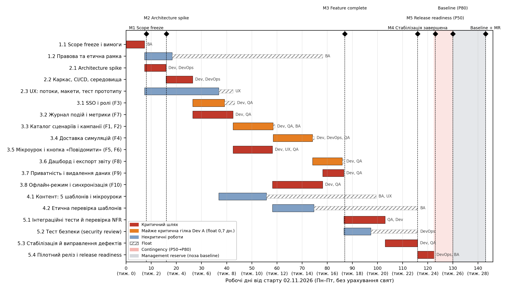

# ЛР 2. Оцінювання розміру, трудомісткості та строку

> Дисципліна: «Економіка ПЗ» · Продукт: SafeStep (варіант 19) · КАІ, 2026  
> Оригінал звіту: [`lr2-size-effort-schedule.pdf`](../../reports/software-economics/lr2-size-effort-schedule.pdf)

## 1. Успадкований scope та журнал змін

Лабораторна продовжує ЛР № 1: продукт SafeStep (тренажер кібербезпеки), первинний сегмент S1 (офісні працівники з високою експозицією до пошти й рахунків), організація на 300–1000 працівників. Обмеження варіанта: симуляції не повинні принижувати або карати працівників. Ключова невизначеність за умовою варіанта – етика симуляцій.

**Scope MVP:** F1 каталог сценаріїв; F2 кампанії; F3 SSO і ролі; F4 доставка симуляцій; F5 мікроурок після дії; F6 кнопка «Повідомити»; F7 єдиний журнал і метрики; F8 агрегований дашборд і експорт; F9 приватність і видалення даних; F10 офлайн-режим із відкладеною синхронізацією; NFR1–NFR5 (продуктивність, доступність, безпека, етичність, зручність). Наскрізний сценарій: кампанія → доставка → дія працівника → мікроурок → журнал → агрегований звіт. Поза MVP: ШІ-генерація сценаріїв, інтеграції HRIS/SIEM, голосові й фізичні симуляції, рейтинги працівників, ML-персоналізація, нативні мобільні застосунки, звіти відповідності.

**Таблиця 1. Журнал змін scope**

| ID | Елемент ЛР № 1 | Статус | Зміна / причина | Вплив |
|---|---|---|---|---|
| S1 | F1–F9 | без змін | Перенесено без змін; кожна функція – окремий backlog item | Входять до 116 SP |
| S2 | F10 Офлайн-режим | уточнено | Критерій розбито на дві перевірювані частини: відкриття кешованого мікроуроку ≤ 3 с та синхронізація 100 подій без втрат і дублікатів; додано дедуплікацію подій | Найширший діапазон O/M/P (WBS 3.8) |
| S3 | NFR1–NFR5 | уточнено | У backlog зведено в один item; перевірки NFR винесено в WBS 5.1, перевірку безпеки – у 5.2 | Окремі роботи QA та DevOps |
| S4 | NFR4: ≤ 2 симуляції на людину на місяць | уточнено | Реалізується перевіркою при створенні кампанії (в межах F2), а не окремою функцією | Без нового item; враховано в WBS 3.3 |
| S5 | Discovery D1–D4 (інтерв’ю, юр. консультація, прототип) | без змін | Вважаються виконаними до старту; в оцінку входить delivery до пілотного релізу, а повторні перевірки A3 і A4 – як WBS 1.2 і 2.3 | Оцінка не включає discovery |
| S6 | Перелік «поза MVP» | без змін | ШІ-генерація, HRIS/SIEM, рейтинги тощо не оцінюються | Прогноз їх не покриває |

## 2. WBS

WBS складається з 20 листових пакетів (19 робіт у мережі + пакет керування проєктом 1.3), кожен із завершуваним результатом, роллю й критерієм готовності (DoD). Типи зв’язків: **FS** – finish-to-start за змістом; **FS (ресурсна)** – пакет чекає, бо його виконує той самий розробник. Зв’язки SS не використано: 5.1 і 5.2 стартують одночасно після завершення розроблення. Зовнішні очікування: юрист (1.2), ІТ-адміністратор клієнта для allowlist (3.4), рецензенти HR/юрист (4.2), зовнішній рецензент безпеки (5.2). Розробники працюють у двох гілках: **Dev A** (3.1 → 3.3 → 3.4 → 3.6) і **Dev B** (3.2 → 3.5 → 3.8 → 3.7).

**Таблиця 2. WBS**

| WBS ID | Пакет / результат | Попередник | Роль | DoD |
|---|---|---|---|---|
| 1.1 | Зафіксований scope і оцінений backlog 116 SP | — | BA/PM | Scope підписано; backlog оцінено |
| 1.2 | Правова й етична рамка: чек-лист приватності, політика «без санкцій» | 1.1 FS | BA/PM; юрист (зовн.) | Письмове «допустимо» для агрегованої моделі; політику підписано |
| 2.1 | Architecture spike: SSO, доставка, офлайн-синхронізація | 1.1 FS | Dev, DevOps | Рішення задокументовані; 3 технічні ризики перевірено прототипом |
| 2.2 | Каркас системи, CI/CD, середовища | 2.1 FS | Dev, DevOps | Збірка й розгортання на тест ≤ 10 хв; 2 середовища |
| 2.3 | UX: потоки, макети, тест прототипу | 1.1 FS | UX | 10 працівників; ≥ 7 завершують сценарій без допомоги |
| 3.1 | SSO і ролі (F3) | 2.2 FS | Dev (A) | 3 ролі; 100% входів через SSO |
| 3.2 | Єдиний журнал подій і метрики (F7) | 2.2 FS | Dev (B) | 4 визначення метрик; розбіжність на тестовому наборі 0% |
| 3.3 | Каталог сценаріїв і кампанії (F1, F2) | 3.1 FS (ресурсна), 3.2 FS | Dev (A) | 5 шаблонів; кампанія на 300 осіб створюється ≤ 10 хв |
| 3.4 | Доставка симуляцій (F4) | 3.3 FS | Dev (A), DevOps | ≥ 95% повідомлень за ≤ 15 хв на 1000 отримувачів |
| 3.5 | Мікроурок і кнопка «Повідомити» (F5, F6) | 3.2 FS, 2.3 FS | Dev (B), UX | Мікроурок ≤ 2 с після дії; подія фіксується ≤ 5 с |
| 3.6 | Агрегований дашборд і експорт (F8) | 3.2 FS, 3.4 FS (ресурсна) | Dev (A) | Експорт ≤ 30 с; групи < 10 осіб не відображаються |
| 3.7 | Приватність і видалення даних (F9) | 3.2, 1.2 FS; 3.8 FS (ресурсна) | Dev (B) | Автовидалення через 12 міс. перевірено на тесті |
| 3.8 | Офлайн-режим і синхронізація (F10) | 3.5 FS | Dev (B) | 100 подій: 0 втрат, 0 дублікатів, синхронізація ≤ 5 хв |
| 4.1 | Контент: 5 шаблонів і мікроуроки | 2.3 FS | BA, UX | Чек-лист тону пройдено для 100% шаблонів |
| 4.2 | Етична перевірка шаблонів | 4.1 FS, 3.5 FS | BA/PM; рецензенти (зовн.) | 0 образливих шаблонів; ≥ 80% позитивних оцінок коректності |
| 5.1 | Інтеграційні тести й перевірка NFR1–NFR5 | 3.4, 3.6, 3.7, 3.8 FS | QA, Dev | NFR1–NFR5 виконано за порогами з ЛР № 1 |
| 5.2 | Перевірка безпеки (security review) | 3.4, 3.6, 3.7, 3.8 FS (паралельно з 5.1) | DevOps; рецензент (зовн.) | 0 відкритих критичних і високих вразливостей |
| 5.3 | Стабілізація й виправлення дефектів | 5.1 FS | Dev, QA | 0 блокерів; ≤ 5 дефектів середньої важливості |
| 5.4 | Пілотний реліз і release readiness | 5.3, 5.2, 4.2 FS | DevOps, BA/PM | Розгорнуто; фахівця безпеки навчено; чек-лист релізу пройдено |
| 1.3 | Керування проєктом (level of effort) | протягом проєкту | BA/PM (0,2 FTE) | Щотижневий статус; журнал ризиків актуальний |

## 3. PERT і мережа залежностей

Для 6 ключових пакетів задано O/M/P (робочі дні календарної тривалості за доступності ролей); O ≤ M ≤ P, scope кожного пакета відповідає WBS (одиниця – робочі дні). **E = (O + 4M + P)/6; σ = (P − O)/6; Var = σ².** Оцінки для решти пакетів наведено в додатку А.

**Таблиця 3. PERT (6 ключових робіт)**

| ID | O | M | P | E | σ | Var | Пояснення P |
|---|--:|--:|--:|--:|--:|--:|---|
| 3.8 | 10 | 18 | 38 | 20,00 | 4,67 | 21,78 | Найширший діапазон (P−O = 28 дн.): синхронізація черги подій, дедуплікація, поведінка кешу в різних браузерах; до spike невідомо, чи вистачить обраного підходу |
| 4.2 | 8 | 14 | 35 | 16,50 | 4,50 | 20,25 | Другий за шириною (P−O = 27 дн.): залежить від зовнішніх рецензентів HR і юриста та від результату тесту тону на працівниках – це етична невизначеність варіанта |
| 3.4 | 8 | 14 | 30 | 15,67 | 3,67 | 13,44 | Очікування налаштування allowlist ІТ-адміністратором клієнта й тест проходження через поштові фільтри |
| 3.2 | 10 | 15 | 26 | 16,00 | 2,67 | 7,11 | Єдина модель подій і 4 визначення метрик потребують узгодження зі спеціалістом безпеки |
| 5.1 | 10 | 15 | 28 | 16,33 | 3,00 | 9,00 | Обсяг дефектів, знайдених під час перевірки NFR, невідомий наперед |
| 1.2 | 6 | 10 | 20 | 11,00 | 2,33 | 5,44 | Відповідь юриста може прийти за 1–3 тижні (зовнішнє очікування) |

**Два найширші діапазони.** Пакет 3.8 (офлайн-режим) має найбільший розкид через технічну новизну; пакет 4.2 (етична перевірка) – через залежність від зовнішніх людей. Обидва розкиди описано лише в O/M/P цих пакетів: ризик не повторюється ні в інших пакетах, ні в management reserve.

**Мережа.** Паралельні гілки: Dev A та Dev B; UX і контент (2.3 → 4.1 → 4.2); QA/безпека (5.1 ‖ 5.2). **Критичний шлях (за E): 1.1 → 2.1 → 2.2 → 3.2 → 3.5 → 3.8 → 3.7 → 5.1 → 5.3 → 5.4.** Гілка Dev A (3.1 → 3.3 → 3.4 → 3.6) майже критична: запас лише 0,7 дня. Пакети 4.1 і 4.2 мають запас 43,7 і 41,3 дня, тому їхня тривалість не впливає на дату, поки не буде перевищено цей запас. Розробники в Dev A і Dev B працюють одночасно, але сума тривалостей паралельних робіт не додається: шлях рахується лише по найдовшій послідовності.

## 4. Agile-прогноз

Backlog з варіанта (116 SP) розкладено на 12 items однією командою за шкалою 1, 2, 3, 5, 8, 13. Еталон – F6 «Кнопка “Повідомити”» (3 SP): проста подія з підтвердженням. Items 13 SP позначають складні функції з кількома інтеграціями; їх варто декомпозувати на початку розроблення.

**Таблиця 4а. Backlog**

| Backlog item | SP | Backlog item | SP |
|---|--:|---|--:|
| F1 Каталог сценаріїв (5 шаблонів) | 8 | F7 Єдиний журнал і метрики | 13 |
| F2 Кампанії: групи, розклад | 13 | F8 Дашборд і експорт звіту | 13 |
| F3 SSO і ролі | 8 | F9 Приватність і видалення даних | 8 |
| F4 Доставка симуляцій | 13 | F10 Офлайн-режим і синхронізація | 13 |
| F5 Мікроурок після дії | 8 | NFR1–NFR5 (продуктивність, доступність, безпека, етика) | 13 |
| F6 Кнопка «Повідомити» | 3 | Інтеграційний пілот і release readiness | 3 |
| **Разом** | | | **116** |

**Таблиця 4. Agile-прогноз**

| Backlog | Velocity S1…S6 | Медіана | Спринти: fast / central / slow | Тижні (спринт 2 тижні) |
|---|---|---|---|---|
| 116 SP | 16, 18, 15, 20, 17, 19 | 17,5 (відсортовано: 15, 16, 17, 18, 19, 20; (17+18)/2) | fast: 116/20 = 5,8 → 6 central: 116/17,5 = 6,63 → 7 slow: 116/15 = 7,73 → 8 | 12 / 14 / 16 |

Діапазон 6–8 спринтів – емпіричні мінімум і максимум шести спринтів умовної команди, а не довірчий інтервал. Прогноз стосується лише розроблення backlog: він не містить discovery, етичної перевірки, перевірки безпеки та випуску. SP не переводяться в години.

## 5. UCP / параметрична модель

Класифікація за правилами методички: актор simple – системний API (1), average – протокол або командний інтерфейс (2), complex – людина через GUI (3); use case simple ≤ 3 транзакцій (5), average 4–7 (10), complex ≥ 8 (15). Кількості задано варіантом: актори 2/3/1, use cases 4/4/2.

**Таблиця 5а. Класифікація акторів і use cases**

| Тип | Елементи |
|---|---|
| Актори simple (2) | Поштовий сервіс доставки (API); служба каталогу користувачів (API імпорту груп) |
| Актори average (3) | SSO-провайдер (протокол OIDC/SAML); працівник (взаємодія переважно через лист і легку сторінку мікроуроку); керівник/аудитор (отримує експорт звіту) |
| Актор complex (1) | Фахівець безпеки (GUI-кабінет) |
| UC simple (4) | UC1 вхід через SSO (3 транзакції); UC2 перегляд політики приватності (2); UC3 повідомити про підозрілий лист (3); UC4 експорт звіту (3) |
| UC average (4) | UC5 вибір шаблону з каталогу (5); UC6 імпорт і керування групами (6); UC7 перегляд агрегованого дашборда (5); UC8 проходження мікроуроку онлайн (5) |
| UC complex (2) | UC9 створення і запуск кампанії (9 транзакцій); UC10 офлайн-проходження й синхронізація (8) |

**Таблиця 5. UCP**

| Компонент | Кількість | Вага | Результат |
|---|---|---|---|
| Прості / середні / складні актори | 2/3/1 | 1/2/3 | UAW = 2 + 6 + 3 = 11 |
| Прості / середні / складні UC | 4/4/2 | 5 / 10 / 15 | UUCW = 20 + 40 + 30 = 90 |
| UUCP | | | UAW + UUCW = 101 |
| TCF × ECF | | 0,95 × 0,87 | 0,8265 |
| UCP | | | 101 × 0,8265 = 83,48 |
| PF, люд.-год/UCP | | 24 | — |
| **Effort** | | | **83,48 × 24 = 2003,4 люд.-год** |

**Вплив коефіцієнтів.** Обидва коефіцієнти менші за 1, тому зменшують UCP: TCF = 0,95 означає технічну складність трохи нижчу за номінальну, ECF = 0,87 – сприятливе середовище команди. Без них UUCP = 101 дав би 2424 год; поправка дає −17%. **Чутливість до класифікації.** Якщо працівника й аудитора вважати складними акторами (GUI), UAW = 13 і effort зростає до 2043 год (+2%), тобто класифікація акторів впливає слабко.

**Таблиця 5б. Чутливість PF та перехід до строку через ресурсний календар**

| Сценарій | PF | Effort, год | Наївно (÷105), тижні | З ролями, тижні | Вузьке місце |
|---|--:|--:|--:|--:|---|
| PF −20% | 19,2 | 1602,7 | 15,3 | 17,2 | BA/PM 17,2; Dev 17,1 |
| PF базовий | 24 | 2003,4 | 19,1 | 21,6 | BA/PM 21,6; Dev 21,3 |
| PF +20% | 28,8 | 2404,1 | 22,9 | 25,9 | BA/PM 25,9; Dev 25,6 |

**Рольовий календар:** місткість ролей на тиждень – BA/PM 14, розробники 56, QA 21, UX 7, DevOps 7 (разом 105 год). Частки effort за ролями: Dev 59,6%, QA 18,1%, BA/PM 15,1%, UX 3,8%, DevOps 3,4%. Тривалість ролі = її effort / її місткість; строк не менший за максимум. Для базового PF вузьким місцем є BA/PM (21,6 тижня), лише трохи випереджаючи розробників (21,3); управлінське навантаження розтягнуте на весь проєкт. Це нижня межа, бо залежності й очікування не враховано. Механічний поділ 2003 год на 105 дав би 19,1 тижня, що хибно ігнорує ролі.

## 6. P50/P80, календар і резерв

Критичний шлях 1.1 → 2.1 → 2.2 → 3.2 → 3.5 → 3.8 → 3.7 → 5.1 → 5.3 → 5.4 складається з 10 послідовних робіт; μ = ΣE = 122,5 дня, ΣVar = 61,31 дн², σ = 7,83 дня. **P80 ≈ 122,5 + 0,842 × 7,83 = 129,1 дня.**

**Таблиця 6. Календар і резерв**

| Показник | Значення | Одиниця | Пояснення |
|---|---|---|---|
| Критичний шлях | 1.1 → 2.1 → 2.2 → 3.2 → 3.5 → 3.8 → 3.7 → 5.1 → 5.3 → 5.4 | — | μ = 122,5 дня (24,5 тижня); майже критична гілка Dev A (запас 0,7 дня) |
| P50 | 122,5 (до 21.04.2027) | роб. днів | P50 ≈ μ |
| P80 | 129,1 | роб. днів | μ + 0,842 · σшляху |
| Contingency | 6,6 | роб. днів | P80 − P50; входить до baseline |
| **Baseline** | **130 (26 тижнів)** | роб. днів | P80, округлено вгору; містить contingency |
| Management reserve | 13 | роб. днів | 10% baseline (П); поза baseline; для нерозпізнаних ризиків |
| Baseline-дата | 30.04.2027 | дата | Старт 02.11.2026, Пн–Пт без свят; з резервом: 19.05.2027 |

**Обмеження наближення.** Формула припускає незалежні роботи й незмінний критичний шлях, а тут гілка Dev A майже критична. Тому виконано перевірку симуляцією (20 000 прогонів із розподілом beta-PERT для всіх 19 пакетів): середнє 125,9, P50 125,8, P80 132,6 дня, тобто P80 вищий на 3,5 дня. Baseline взято за формулою методички, а різницю названо відомою похибкою: вона не покривається management reserve, який зарезервовано лише під нерозпізнані ризики. P80 – це 80% ймовірності за прийнятими припущеннями, а не точна дата.

**Уникнення подвійного обліку.** Невизначеність відомих робіт (включно з етичною перевіркою 4.2 і офлайн-режимом 3.8) закладена лише в O/M/P, тобто в P80 і contingency. У management reserve лежить те, чого в O/M/P немає: наприклад, повторне доопрацювання шаблонів після етичної перевірки (+10 днів на гілці 3.5 → 3.8, бо вона критична) або вибуття розробника на 2 тижні (+10 днів).

**Таблиця 6а. Віхи (за P50) і baseline**

| Віха | Завершення пакета | Робочий день (P50) | Дата |
|---|---|--:|---|
| M1 Scope freeze | 1.1 | 8 | 11.11.2026 |
| M2 Architecture spike | 2.1 | 16 | 23.11.2026 |
| M3 Feature complete | 3.7 (остання функція) | 87 | 02.03.2027 |
| M4 Stabilization | 5.3 | 116 | 12.04.2027 |
| M5 Release readiness (P50) | 5.4 | 123 | 21.04.2027 |
| Baseline (P80) | — | 130 | 30.04.2027 |
| Baseline + management reserve | — | 143 | 19.05.2027 |

*Рисунок 1. Діаграма Ґанта з віхами, критичним шляхом і резервом. Червоні – критичний шлях; помаранчеві – майже критична гілка Dev A; штриховка – float; рожева зона – contingency (P50 → P80); сіра – management reserve.*

## 7. Порівняння методів і baseline

**Таблиця 7. Порівняння трьох методів (спільні одиниці: effort – люд.-год, тривалість – тижні)**

| Метод | Розмір | Effort | Duration / діапазон | Сила | Обмеження |
|---|---|---|---|---|---|
| PERT/WBS | 20 пакетів | 1594,5 год (знизу вгору; 62% місткості команди за 24,5 тиж.) | P50 24,5 тиж.; P80 25,8 тиж.; baseline 26 тиж.; з резервом 28,6; симуляція P80 26,5 | Бачить залежності, ролі, зовнішні очікування й ризик | Суб’єктивні O/M/P; наближення P80; перемикання шляху |
| SP/velocity | 116 SP | не оцінюється (SP ≠ години) | 6/7/8 спринтів = 12/14/16 тиж. | Швидко, спирається на фактичні дані | Лише backlog розроблення; чужа команда; емпіричні межі |
| UCP/parametric | 83,48 UCP (UUCP 101) | 2003,4 год (1602,7–2404,1 при PF ±20%) | Наївно 19,1 тиж.; з ролями 21,6 (17,2–25,9) | Рання оцінка зі сценаріїв | Історичний PF; груба класифікація; без залежностей |

### 7.1. Пояснення розбіжностей

- **Scope.** Agile-прогноз охоплює лише розроблення backlog. У PERT період реалізації функцій (пакети 3.x) триває 60,2 дня = 12,0 тижня, а разом з архітектурою й каркасом (2.1–2.2) – 79,3 дня = 15,9 тижня. Обидва значення лежать у діапазоні agile 12–16 тижнів. Решта строку PERT – discovery-повтори, етична перевірка, безпека, стабілізація й реліз.
- **Дані.** Velocity і PF – історичні дані іншої команди або організації; PERT спирається на експертні O/M/P нашого проєкту. Тому порівняння корисне як перехресна перевірка, а не як доказ точності.
- **Залежності.** UCP та agile не знають про мережу робіт; PERT показує, що гілки Dev A і Dev B майже рівні й що UX/контент має запас 40+ днів.
- **Ролі.** Наївний UCP-строк (19,1 тиж.) нижчий за рольовий (21,6), бо BA/PM і розробники мають обмежену місткість. Загальний effort UCP (2003 год) вкладається в місткість команди за P50 (2572 год) із завантаженням 78%, а WBS-effort (1595 год) – 62%: різниця – очікування, простої між гілками й накладні витрати, яких немає в WBS.
- **Ризик.** Тільки PERT явно моделює невизначеність і дає P50/P80; agile і UCP дають діапазони без ймовірностей.

**Baseline.** Найнадійнішим у цьому кейсі є PERT/WBS: він найдетальніший, враховує залежності, ролі та зовнішні очікування. Він перехресно підтверджений іншими методами: верхня межа UCP з ролями (25,9 тиж.) збігається з baseline (26 тиж.), а agile-діапазон відповідає лише періоду розроблення. Тому **baseline = 130 робочих днів (26 тижнів), дата 30.04.2027**, P50 = 122,5 дня (21.04.2027), P80 = 129,1 дня, contingency = 6,6 дня; management reserve = 13 днів окремо (з ним 19.05.2027).

## 8. Висновки та захист baseline

**Паспорт baseline**

| Параметр | Значення |
|---|---|
| Scope | F1–F10 і NFR1–NFR5 з ЛР № 1; поза MVP – перелік у розділі 1 |
| Строк | 130 робочих днів (26 тижнів) від 02.11.2026 → 30.04.2027 (Пн–Пт, без свят) |
| P50 / P80 | 122,5 / 129,1 дня; симуляція P80 = 132,6 дня |
| Contingency / MR | 6,6 дня у baseline / 13 днів окремо (до 19.05.2027) |
| Віхи | M1 11.11.2026; M2 23.11.2026; M3 02.03.2027; M4 12.04.2027; M5 21.04.2027 (за P50) |
| Effort | WBS 1594,5 год; UCP 2003,4 год (1602,7–2404,1) |

**Три тригери перегляду оцінки:**

1. Власна медіана velocity після перших трьох спринтів нижча за 15 SP (мінімум умовної команди): тоді 116 SP потребують понад 8 спринтів, і строк розроблення виходить за межі прогнозу.
2. Пакет 3.8 (офлайн-режим): за результатами spike або двох ітерацій оцінка перевищує P = 38 днів або критерій «0 втрат, 0 дублікатів» не досягнуто; тоді скорочуємо F10 або переносимо дату.
3. Етична перевірка 4.2 або правова рамка 1.2: менше 80% позитивних оцінок коректності, потреба переписати понад 2 із 5 шаблонів чи заборона агрегованої моделі юристом; тоді спрацьовує management reserve, а при його вичерпанні – перегляд дати.

**Загальний висновок.** Той самий MVP SafeStep оцінено трьома методами. Базовий строк – 26 тижнів із резервом 13 робочих днів поза baseline. Рівень впевненості – помірний: визначальні невизначеності – офлайн-режим і етична перевірка, і їх варто зменшити першими.

1. Найнадійніший метод – PERT/WBS, бо враховує залежності, ролі, очікування й ризик; інші методи слугують перехресною перевіркою.
2. Перегляд baseline спричинить спрацювання одного з трьох тригерів, наприклад, невдача кешування й синхронізації в офлайн-режимі (F10) або заборона юристом агрегованої моделі даних.

## Додаток А. PERT і календар для всіх пакетів

Тривалості – робочі дні; ES/EF – найраніші старт і фініш за E; float = LF − EF; «Крит.» – належність до критичного шляху. Пакет 1.3 – level of effort, у мережі не бере участі.

**Таблиця А1. Розрахунок за пакетами**

| ID | Пакет | O | M | P | E | σ | ES | EF | Float | Крит. |
|---|---|--:|--:|--:|--:|--:|--:|--:|--:|:-:|
| 1.1 | Scope freeze і вимоги | 4 | 7 | 12 | 7,33 | 1,33 | 0,0 | 7,3 | 0,0 | так |
| 1.2 | Правова та етична рамка | 6 | 10 | 20 | 11,00 | 2,33 | 7,3 | 18,3 | 59,8 | ні |
| 2.1 | Architecture spike | 5 | 8 | 14 | 8,50 | 1,50 | 7,3 | 15,8 | 0,0 | так |
| 2.2 | Каркас, CI/CD, середовища | 6 | 10 | 18 | 10,67 | 2,00 | 15,8 | 26,5 | 0,0 | так |
| 2.3 | UX: потоки, макети, тест прототипу | 20 | 28 | 45 | 29,50 | 4,17 | 7,3 | 36,8 | 5,7 | ні |
| 3.1 | SSO і ролі (F3) | 8 | 12 | 20 | 12,67 | 2,00 | 26,5 | 39,2 | 4,0 | ні |
| 3.2 | Журнал подій і метрики (F7) | 10 | 15 | 26 | 16,00 | 2,67 | 26,5 | 42,5 | 0,0 | так |
| 3.3 | Каталог сценаріїв і кампанії (F1, F2) | 10 | 15 | 26 | 16,00 | 2,67 | 42,5 | 58,5 | 0,7 | ні |
| 3.4 | Доставка симуляцій (F4) | 8 | 14 | 30 | 15,67 | 3,67 | 58,5 | 74,2 | 0,7 | ні |
| 3.5 | Мікроурок і кнопка «Повідомити» (F5, F6) | 10 | 15 | 24 | 15,67 | 2,33 | 42,5 | 58,2 | 0,0 | так |
| 3.6 | Дашборд і експорт звіту (F8) | 7 | 11 | 20 | 11,83 | 2,17 | 74,2 | 86,0 | 0,7 | ні |
| 3.7 | Приватність і видалення даних (F9) | 5 | 8 | 14 | 8,50 | 1,50 | 78,2 | 86,7 | 0,0 | так |
| 3.8 | Офлайн-режим і синхронізація (F10) | 10 | 18 | 38 | 20,00 | 4,67 | 58,2 | 78,2 | 0,0 | так |
| 4.1 | Контент: 5 шаблонів і мікроуроки | 12 | 18 | 30 | 19,00 | 3,00 | 36,8 | 55,8 | 43,7 | ні |
| 4.2 | Етична перевірка шаблонів | 8 | 14 | 35 | 16,50 | 4,50 | 58,2 | 74,7 | 41,3 | ні |
| 5.1 | Інтеграційні тести й перевірка NFR | 10 | 15 | 28 | 16,33 | 3,00 | 86,7 | 103,0 | 0,0 | так |
| 5.2 | Тест безпеки (security review) | 6 | 10 | 18 | 10,67 | 2,00 | 86,7 | 97,3 | 18,7 | ні |
| 5.3 | Стабілізація й виправлення дефектів | 8 | 12 | 22 | 13,00 | 2,33 | 103,0 | 116,0 | 0,0 | так |
| 5.4 | Пілотний реліз і release readiness | 3 | 6 | 12 | 6,50 | 1,50 | 116,0 | 122,5 | 0,0 | так |
