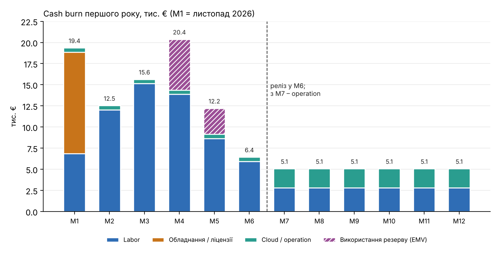
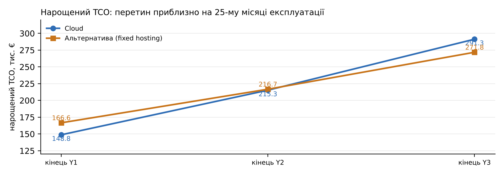

# ЛР 3. Кошторис розроблення та сукупна вартість володіння (TCO)

> Дисципліна: «Економіка ПЗ» · Продукт: SafeStep (варіант 19) · КАІ, 2026  
> Оригінал звіту: [`lr3-cost-estimate-tco.docx`](../../reports/software-economics/lr3-cost-estimate-tco.docx)

## 1. Успадкований scope і журнал припущень

ЛР № 3 продовжує SafeStep (варіант 19). З ЛР № 1 переносимо межі MVP: функції F1–F10 (у т. ч. обов’язкова F10 – офлайн-режим), NFR1–NFR5 і перелік «поза MVP». З ЛР № 2 перенесено WBS із 19 пакетів і пакетом керування проєктом (1.3), трудомісткість, календар і оцінки P50 = 122,5 робочого дня (≈ 5,65 міс.) та P80 = 129,1 дня (baseline 130 днів). Нових функцій не додано. Валюта – євро, ціни сталі (без інфляції й дисконтування) в обох сценаріях; growth у варіанті моделює зростання використання, а не інфляцію.

**Таблиця 1. Журнал припущень (П – припущення автора)**

| ID | Припущення                               | Значення                                                                              | Підстава або джерело                                                                                                        | Вплив помилки                                               |
|--------|----------------------------------------------|-------------------------------------------------------------------------------------------|---------------------------------------------------------------------------------------------------------------------------------|-----------------------------------------------------------------|
| A1     | Валюта, ціни, горизонт                       | EUR; сталі ціни 2026; без дисконтування; 3 роки експлуатації після релізу                 | Єдиний підхід в обох сценаріях                                                                                                  | Зсуває обидва TCO однаково; на порядок сценаріїв впливає слабко |
| A2     | Loaded rate, набір A                         | BA/PM 4 200; UX 3 900; Dev 5 200; QA 3 800; DevOps 5 500 €/міс.                           | Входить: брутто-зарплата, податки й внески роботодавця, бенефіти, розподілені накладні. Не входить: обладнання, ліцензії, cloud | Подвійний облік накладних завищить labor                        |
| A3     | Effort і календар                            | 19 пакетів + LOE; P50 122,5 дня; baseline 130 днів                                        | ЛР № 2                                                                                                                          | Зсув строку змінює labor пропорційно                            |
| A4     | Місяць у робочих днях                        | 21,67 (260 / 12)                                                                          | П                                                                                                                               | Малий; впливає на FTE-місяці й розподіл по місяцях              |
| A5     | Завантаження ролей                           | Оплачується фактичне завантаження за WBS: 13,1 FTE-міс.                                   | П: недозавантаження часткових ролей використовується на інших проєктах                                                          | Якщо команду виділено повністю: labor 100 073 € (+37 561 €)     |
| A6     | Фази                                         | Аналіз: 1.1–1.2; Проєктування: 2.1, 2.3; Розроблення: 2.2, 3.x, 4.1; Тест/реліз: 4.2, 5.x | Укрупнення WBS ЛР № 2                                                                                                           | Не змінює суму, лише розподіл по фазах                          |
| A7     | Реліз і operation                            | Реліз у M6 (≈ 21.04.2027, P50); operation з M7                                            | ЛР № 2                                                                                                                          | Зсув релізу переносить operation і cash burn                    |
| A8     | Ризик 2                                      | p = 30%; impact = 10 200 €                                                                | Припущення A3 з ЛР № 1; impact = 1,0 Dev + 0,5 QA + 0,5 BA FTE-міс. + 1 000 € юриста                                            | Впливає лише на contingency                                     |
| A9     | Contingency                                  | = Σ EMV двох ризиків = 9 060 €                                                            | Розділ 3.2 методички                                                                                                            | Не 10% довільно                                                 |
| A10    | Management reserve                           | 6 634 € (13 днів × 510 €/день)                                                            | 13 днів із ЛР № 2                                                                                                               | Поза baseline; не є cash burn                                   |
| A11    | Альтернатива                                 | Fixed hosting у ЄС: start 30 000 €; op 15 000 €/рік; потужність під навантаження Y3       | Варіант 19; вибір мій: дані лишаються під контролем (F9, A3); однакові scope і SLA 99,5% (NFR2)                                 | Якщо навантаження менше за Y3 – start переплачено               |
| A12    | Support і change (однакові в обох сценаріях) | Support 23 880 €/рік (0,4 FTE за ролями); change 9 990 €/рік                              | П: квартальне оновлення сценаріїв (O4, ЛР № 1)                                                                                  | Піднімає TCO обох сценаріїв; на різницю не впливає              |
| A13    | Пострелізні ризики                           | Cloud: 20% × 25% річних витрат cloud; альтернатива: 15% × 8 000 €                         | П; поза cost baseline MVP                                                                                                       | Малий (≈ 3–5 тис. € за 3 роки)                                  |
| A14    | Retirement (Y3)                              | Cloud 3 000 €; альтернатива 5 000 €                                                       | П: експорт, акт видалення даних, списання обладнання                                                                            | Малий                                                           |

## 2. Команда та labor cost за фазами

Команда – 5 ролей з ресурсного календаря ЛР № 2 (BA/PM, UX, Developer, QA, DevOps). FTE-місяці кожної ролі у фазі = Σ(E пакета × частка ролі в пакеті) / 21,67 для пакетів цієї фази; тому роль не оплачується «на повну ставку всі місяці», а лише за фактичне завантаження за WBS. Керування проєктом (BA/PM 0,2 FTE протягом усього проєкту, пакет 1.3) розподілено за календарними вікнами фаз: Аналіз – 18,3 дня; Проєктування – 18,5 дня; Розроблення – 49,8 дня; Тест/реліз – 35,8 дня. Labor cost = Σ(loaded rate × FTE-місяці).

**Таблиця 2. Labor cost за ролями та фазами (FTE-місяці)**

| Роль  | Loaded rate, €/міс. | Аналіз | Проєкту-вання | Розроб-лення | Тест / реліз | Разом FTE-міс. | Вартість, € |
|-----------|-------------------------|------------|-------------------|------------------|------------------|--------------------|-----------------|
| BA/PM     | 4 200                   | 0,47       | 0,17              | 0,67             | 0,67             | 1,98               | 8 314           |
| UX        | 3 900                   | 0,00       | 0,34              | 0,16             | 0,00             | 0,50               | 1 952           |
| Developer | 5 200                   | 0,00       | 0,39              | 5,86             | 1,58             | 7,83               | 40 720          |
| QA        | 3 800                   | 0,00       | 0,00              | 1,51             | 0,87             | 2,38               | 9 038           |
| DevOps    | 5 500                   | 0,00       | 0,06              | 0,20             | 0,20             | 0,45               | 2 488           |
| Разом |                         | 0,47   | 0,96          | 8,40         | 3,31         | 13,14          | 62 512      |

## 3. Baseline MVP і два ризики

До labor cost додано лише прямі проєктні витрати варіанта: обладнання, ліцензії та cloud для розроблення. Overhead повторно не додавався – він уже в loaded rates. Перший ризик задано варіантом (етика симуляцій), другий визначено мною: після перегляду реалізованих F7–F9 юрист або DPO вимагає змінити модель даних (псевдонімізація чи агрегація). Цей ризик не продубльовано в PERT: пакет 1.2 у ЛР № 2 поза критичним шляхом (запас 59,8 дня), а вартість перероблення вже побудованих F7–F9 не міститься в жодному O/M/P.

**Таблиця 3а. Ризики та EMV**

| Ризик                                                         | p | Impact, € | EMV, € | Реакція                      |
|-------------------------------------------------------------------|-------|---------------|------------|----------------------------------|
| R1 Етика симуляцій: шаблони не проходять перевірку тону (варіант) | 50%   | 12 000        | 6 000      | M4 (після етичної перевірки 4.2) |
| R2 Юридична вимога змінити модель даних F7–F9 (мій)               | 30%   | 10 200        | 3 060      | M5 (після Feature complete)      |
| Contingency = Σ EMV                                           |       |               | 9 060  |                                  |

**Таблиця 3. Cost baseline MVP**

| Стаття                 | Сума, € | Додаємо окремо?           | Підстава                    |
|----------------------------|-------------|-------------------------------|---------------------------------|
| Loaded labor               | 62 512      | —                             | таблиця 2                       |
| Обладнання                 | 5 000       | так, не входить у loaded rate | варіант 19                      |
| Ліцензії                   | 7 000       | так, не входить у loaded rate | варіант 19                      |
| Cloud розроблення          | 3 000       | так                           | варіант 19                      |
| Base cost estimate MVP | 77 512  |                               | labor + прямі витрати       |
| Contingency                | 9 060       | так                           | EMV двох ризиків                |
| Cost baseline MVP      | 86 572  |                               | base estimate + contingency |

**Cost baseline MVP = 86 572 €.** Management reserve (6 634 €, 13 днів із ЛР № 2 за середнім денним labor 510 €) показано окремо: разом project budget = 93 206 €. Щоб уникнути подвійного обліку, labor пораховано за P50-трудомісткістю, а календарний contingency ЛР № 2 (P80 − P50 = 6,6 дня) у гроші не переводився: невизначеність у вартості покрито лише EMV двох ризиків. Зауваження: EMV – очікуване значення; якщо R1 настане, його impact (12 000 €) вже більший за весь contingency, і тоді залучають management reserve.

## 4. Помісячний бюджет і cash burn

Вартість кожного пакета WBS розподілено рівномірно за його календарним вікном ES–EF із ЛР № 2 і згруповано по місяцях (місяць = 21,67 робочого дня). Обладнання й ліцензії (12 000 €) сплачуються в M1; cloud розроблення (3 000 €) рівномірно M1–M6. Реліз у M6, з M7 – operation: cloud Y1/12 = 2 250 €/міс. і support + change = 2 823 €/міс. Contingency показано лише в місяцях реакції (M4: 6 000 €; M5: 3 060 €). Невикористаний contingency і management reserve (6 634 €) – не cash burn. Валюта – євро; повна таблиця – у додатку А.

*Рисунок 1. Cash burn першого року (планові витрати за M1–M12).*

**Підсумок року:** планові витрати без резерву – 107 947 €, разом із виділенням резерву – 117 007 €. З них розроблення (labor 62 512 € + прямі 15 000 €) – 77 512 €, решта – перші шість місяців експлуатації. Пік – M4 (20 377 €) через виділення резерву на R1 поверх високого labor (M3–M4 – найбільш завантажена частина розроблення).

## 5. Трирічний TCO, чутливість і порівняння

> ℹ️ У [ЛР 8](lr8-scenarios-business-case.md) cloud operation перераховано за фактичним попитом (Y1 = 9 805 € замість 27 000 €): TCO3 cloud = 251 013 €, і cloud стає дешевшим за fixed hosting. Нижче — початковий розрахунок ЛР 3.

Порівнюються два сценарії з однаковими scope (MVP F1–F10), workload (зростання користувачів за growth варіанта), service level (99,5%) і валютою. **Cloud:** operation Y1 = 27 000 €, Y2 = Y1 × 1,15 = 31 050 €, Y3 = Y2 × 1,20 = 37 260 €. **Альтернатива – fixed hosting** у ЄС: start 30 000 € (Y1, одноразово) і op 15 000 € щороку за умови, що потужність розрахована на навантаження Y3; тому її op не росте. TCO3 = cost baseline MVP + start-up + Σ(operation + support + change + очікувані ризики) + retirement; contingency, уже включений у baseline, вдруге не додається. Роки Y1–Y3 – роки експлуатації після релізу, а MVP / start-up показано в Y1.

**Таблиця 5. Порівняння трирічного TCO, €**

| Компонент  | Cloud Y1 | Cloud Y2 | Cloud Y3 | Альтерн. Y1 | Альтерн. Y2 | Альтерн. Y3 |
|----------------|--------------|--------------|--------------|-----------------|-----------------|-----------------|
| MVP / start-up | 86 572       | 0            | 0            | 116 572         | 0               | 0               |
| Operation      | 27 000       | 31 050       | 37 260       | 15 000          | 15 000          | 15 000          |
| Support        | 23 880       | 23 880       | 23 880       | 23 880          | 23 880          | 23 880          |
| Change і risk  | 11 340       | 11 543       | 11 853       | 11 190          | 11 190          | 11 190          |
| Retirement     | 0            | 0            | 3 000        | 0               | 0               | 5 000           |
| TCO3       | 148 792  | 66 473   | 75 993   | 166 642     | 50 070      | 55 070      |

**TCO3: cloud 291 257 €; альтернатива 271 782 €.** Альтернатива дешевша на 19 476 € (7,2%). Cloud дешевший у Y1 (немає 30 000 € start), але в Y2 і Y3 дорожчий через зростання operation; нарощена різниця змінює знак на ≈ 25-му місяці експлуатації (рисунок 2).

*Рисунок 2. Нарощений TCO двох сценаріїв.*

## Чутливість: ключове припущення ±20%

Головний драйвер різниці – operation cloud Y1. Таблиця 5а показує результат; решту параметрів (growth, op і start альтернативи, loaded rates) – у додатку В.

**Таблиця 5а. Чутливість до ціни cloud Y1 (±20%)**

| Сценарій  | TCO3 Cloud, € | TCO3 Альтерн., € | Δ (Cloud − Альт.), € | Дешевший |
|---------------|-------------------|----------------------|--------------------------|--------------|
| Базовий       | 291 257           | 271 782              | 19 476                   | Альтернатива |
| Cloud Y1 −20% | 271 242           | 271 782              | −540                     | Cloud        |
| Cloud Y1 +20% | 311 272           | 271 782              | 39 491                   | Альтернатива |

## 6. Висновок і baseline

**Baseline:** cost baseline MVP = **86 572 €** (labor 62 512 € + прямі 15 000 € + contingency 9 060 €), project budget з management reserve = 93 206 €, реліз у M6; сценарій – **cloud** зі стартом без капітальних вкладень. Хоча за TCO3 fixed hosting дешевший на 19 476 € (7,2%) і окупає start приблизно на 25-му місяці, ця перевага менша за невизначеність головного драйвера: при зниженні ціни cloud на 20% cloud стає дешевшим на 540 €, а при підвищенні перевага альтернативи зростає до 39 491 €. Навантаження невідоме до пілоту (A8, A9 з ЛР № 1), тому вкладати 30 000 € у потужність під Y3 до появи реальних даних недоцільно. Рекомендація: запустити MVP у cloud (контейнеризація закладена в WBS 2.2) і переглянути вибір після 6 місяців експлуатації, якщо фактичний річний run-rate cloud перевищить 29 700 € (+10%) або зростання користувачів буде вищим за 15%; вартість міграції на fixed hosting тоді потрібно оцінити окремо.

## Додаток А. Помісячний бюджет першого року (€)

Таблиця 4. Валюта – євро; реліз у M6; contingency – лише в місяці реакції (M4, M5); management reserve 6 634 € і невикористаний contingency поза cash burn.

| Стаття           | M1     | M2     | M3     | M4     | M5     | M6    | M7    | M8    | M9    | M10   | M11   | M12   | Разом   |
|----------------------|------------|------------|------------|------------|------------|-----------|-----------|-----------|-----------|-----------|-----------|-----------|-------------|
| Labor                | 6 863      | 12 035     | 15 140     | 13 877     | 8 653      | 5 944     | 2 823     | 2 823     | 2 823     | 2 823     | 2 823     | 2 823     | 79 447      |
| Обладн. / ліцензії   | 12 000     | 0          | 0          | 0          | 0          | 0         | 0         | 0         | 0         | 0         | 0         | 0         | 12 000      |
| Cloud / operation    | 500        | 500        | 500        | 500        | 500        | 500       | 2 250     | 2 250     | 2 250     | 2 250     | 2 250     | 2 250     | 16 500      |
| Використання резерву | 0          | 0          | 0          | 6 000      | 3 060      | 0         | 0         | 0         | 0         | 0         | 0         | 0         | 9 060       |
| Разом cash burn  | 19 363 | 12 535 | 15 640 | 20 377 | 12 213 | 6 444 | 5 073 | 5 073 | 5 073 | 5 073 | 5 073 | 5 073 | 117 007 |
| Нарощений cash burn  | 19 363     | 31 898     | 47 538     | 67 915     | 80 128     | 86 572    | 91 644    | 96 717    | 101 789   | 106 862   | 111 934   | 117 007   |             |

## Додаток Б. Вартість пакетів WBS (джерело labor cost)

| WBS | Пакет                                | Фаза     | E, днів | Вартість, € |
|---------|------------------------------------------|--------------|-------------|-----------------|
| 1.1     | Scope freeze і вимоги                    | Аналіз       | 7,33        | 711             |
| 1.2     | Правова та етична рамка                  | Аналіз       | 11,00       | 533             |
| 2.1     | Architecture spike                       | Проєктування | 8,50        | 2 364           |
| 2.2     | Каркас, CI/CD, середовища                | Розроблення  | 10,67       | 3 237           |
| 2.3     | UX: потоки, макети, тест прототипу       | Проєктування | 29,50       | 1 328           |
| 3.1     | SSO і ролі (F3)                          | Розроблення  | 12,67       | 3 484           |
| 3.2     | Журнал подій і метрики (F7)              | Розроблення  | 16,00       | 4 682           |
| 3.3     | Каталог сценаріїв і кампанії (F1, F2)    | Розроблення  | 16,00       | 4 837           |
| 3.4     | Доставка симуляцій (F4)                  | Розроблення  | 15,67       | 4 982           |
| 3.5     | Мікроурок і кнопка «Повідомити» (F5, F6) | Розроблення  | 15,67       | 4 866           |
| 3.6     | Дашборд і експорт звіту (F8)             | Розроблення  | 11,83       | 3 463           |
| 3.7     | Приватність і видалення даних (F9)       | Розроблення  | 8,50        | 2 338           |
| 3.8     | Офлайн-режим і синхронізація (F10)       | Розроблення  | 20,00       | 5 852           |
| 4.1     | Контент: 5 шаблонів і мікроуроки         | Розроблення  | 19,00       | 1 079           |
| 4.2     | Етична перевірка шаблонів                | Тест/реліз   | 16,50       | 800             |
| 5.1     | Інтеграційні тести й перевірка NFR       | Тест/реліз   | 16,33       | 4 108           |
| 5.2     | Тест безпеки (security review)           | Тест/реліз   | 10,67       | 677             |
| 5.3     | Стабілізація й виправлення дефектів      | Тест/реліз   | 13,00       | 7 380           |
| 5.4     | Пілотний реліз і release readiness       | Тест/реліз   | 6,50        | 1 043           |
| 1.3     | Керування проєктом (LOE)                 | LOE          | 122,50      | 4 749           |
|         | Разом                                |              |             | 62 512      |

## Додаток В. Повна таблиця чутливості TCO3 (€)

| Сценарій            | Cloud | Альтернатива | Δ (Cloud − Альт.) | Дешевший | Δ відносно бази |
|-------------------------|-----------|------------------|-----------------------|--------------|---------------------|
| Базовий                 | 291 257   | 271 782          | 19 476                | Альтернатива | 0                   |
| Cloud Y1 −20%           | 271 242   | 271 782          | −540                  | Cloud        | −20 015             |
| Cloud Y1 +20%           | 311 272   | 271 782          | 39 491                | Альтернатива | 20 015              |
| Growth −20% (12% / 16%) | 288 116   | 271 782          | 16 334                | Альтернатива | −3 141              |
| Growth +20% (18% / 24%) | 294 466   | 271 782          | 22 685                | Альтернатива | 3 209               |
| Alt operation −20%      | 291 257   | 262 782          | 28 476                | Альтернатива | 9 000               |
| Alt operation +20%      | 291 257   | 280 782          | 10 476                | Альтернатива | −9 000              |
| Alt start −20%          | 291 257   | 265 782          | 25 476                | Альтернатива | 6 000               |
| Alt start +20%          | 291 257   | 277 782          | 13 476                | Альтернатива | −6 000              |
| Loaded rates −20%       | 258 433   | 238 957          | 19 476                | Альтернатива | 0                   |
| Loaded rates +20%       | 324 082   | 304 606          | 19 476                | Альтернатива | 0                   |

Примітки: у рядках «Loaded rates» перераховано labor, support і change; contingency і impact ризиків не змінювалися. Альтернативне припущення A5 (команда виділена повністю): labor 100 073 € замість 62 512 €, cost baseline MVP 124 133 €; на різницю сценаріїв це не впливає, бо baseline спільний.
