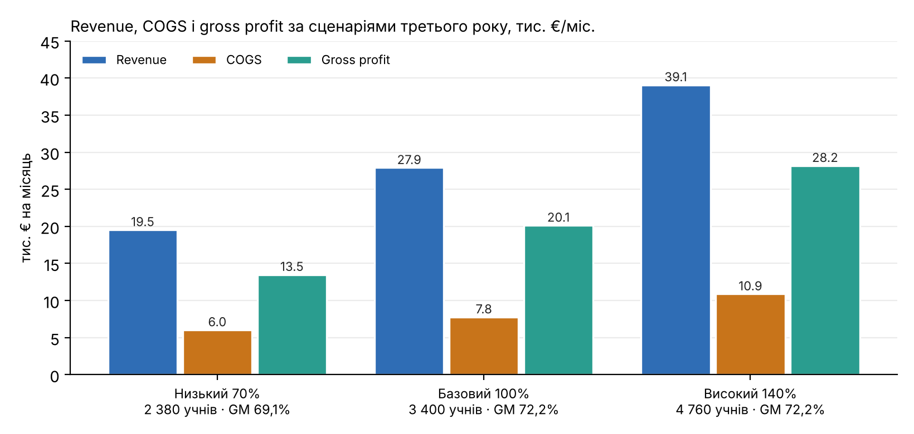

# ЛР 4. Модель монетизації та тарифна сітка

> Дисципліна: «Економіка ПЗ» · Продукт: SafeStep (варіант 19) · КАІ, 2026  
> Оригінал звіту: [`lr4-monetization-pricing.docx`](../../reports/software-economics/lr4-monetization-pricing.docx)

## 1. Успадковані дані та журнал припущень

ЛР № 4 продовжує SafeStep (варіант 19). У таблиці 0 відокремлено **задані дані** (варіант і попередні роботи); власні припущення подано в таблиці 1; результати розрахунку – у розділах 3–5. Усі суми – у євро, розрахунковий період – календарний місяць, платна одиниця – активний учень за місяць.

**Таблиця 0. Задані дані**

| Параметр                    | Значення                                                                                            | Джерело                                                                                                                                              |
|---------------------------------|---------------------------------------------------------------------------------------------------------|----------------------------------------------------------------------------------------------------------------------------------------------------------|
| Галузь, продукт                 | Кібербезпека – тренажер кібербезпеки                                                                    | Варіант 19                                                                                                                                               |
| Стартова модель, pricing metric | Hybrid base + usage; учень                                                                              | Варіант 19                                                                                                                                               |
| Масштаб третього року           | 3 400 учнів на місяць                                                                                   | Варіант 19                                                                                                                                               |
| COGS на одиницю; target GM      | €1,70 на учня на місяць; 65% (0,65)                                                                     | Варіант 19                                                                                                                                               |
| MVP / команда                   | 7 міс. / 6 осіб                                                                                         | Варіант 19; узгоджено з ЛР № 2: baseline 130 + management reserve 13 = 143 робочі дні ≈ 6,6 міс.; 6 осіб = BA/PM, UX, 2 Developer, QA, DevOps (3,75 FTE) |
| Scope MVP, користувачі          | F1–F10, NFR1–NFR5; працівник, фахівець безпеки, керівник; клієнт – організація на 300–1 000 працівників | ЛР № 1                                                                                                                                                   |
| Cost drivers і TCO              | Support 1 990 €/міс. (0,4 FTE); cloud Y3 37 260 €/рік; cost baseline MVP 86 572 €                       | ЛР № 3                                                                                                                                                   |

**Таблиця 1. Журнал припущень (П – припущення автора)**

| ID | Припущення                            | Значення                                                              | Підстава                                                                                            | Що змінює  |
|--------|-------------------------------------------|---------------------------------------------------------------------------|---------------------------------------------------------------------------------------------------------|----------------|
| A1     | Розподіл клієнтів за тарифами             | 40 Basic / 16 Standard / 4 Pro (66,7% / 26,7% / 6,7%) = 60 клієнтів       | П: більшість клієнтів – пілотні й малі групи, мало великих організацій; потребує перевірки в пілоті     | Revenue і COGS |
| A2     | Середнє usage (активних учнів на клієнта) | 20 / 80 / 330 (≈ 80–83% від ліміту); Σ = 3 400                            | П: адміністратор записує на навчання групу, а не всіх працівників; сума збігається з масштабом варіанта | COGS і margin  |
| A3     | Високе usage                              | Basic 60, Standard 160, Pro 700 учнів                                     | П: клієнт перевищує ліміт на 60–140%                                                                    | ризик тарифу   |
| A4     | COGS на клієнта (підтримка)               | Пул 1 990 €/міс. розподілено за вагами 1 / 2 / 4: 22,61 / 45,23 / 90,45 € | ЛР № 3: support; розподіл за рівнем обслуговування (додаток А)                                          | COGS пакета    |
| A5     | Масштабування підтримки                   | Step-fixed: пул не менший за 1 990 € і росте при масштабі \> 100%         | П: 0,4 FTE не можна зменшити пропорційно попиту                                                         | GM у сценаріях |
| A6     | Що входить у COGS                         | Variable COGS учня + підтримка клієнтів                                   | Cloud, пошта, зберігання, комісії – у €1,70; не входять: бюджет MVP, change/розвиток (ЛР № 3)           | Коректність GM |
| A7     | Сценарії попиту                           | Змінюється лише кількість клієнтів; ціни, mix і usage на клієнта сталі    | Вимога методички: не змінювати попит і ціну разом                                                       | Сценарії       |

## 2. Матриця моделей монетизації та pricing metric

Порівняно задану модель і дві альтернативи за п’ятьма критеріями (бали 1–5, 5 – найкраще; ваги: відповідність цінності 25%, передбачуваність доходу 25%, захист від надмірного використання 20%, простота продажу 15%, вплив на поведінку клієнта 15%).

**Таблиця 2. Матриця моделей монетизації**

| Модель                            | Pricing metric                                     | Перевага                                                                | Ризик                                                                                                      | Оцінка 1–5 |
|---------------------------------------|--------------------------------------------------------|-----------------------------------------------------------------------------|----------------------------------------------------------------------------------------------------------------|----------------|
| Задана: hybrid base + usage           | Базовий платіж за клієнта + активний учень понад ліміт | Передбачувана база й оплата зростання охоплення; ціна пов’язана з навченими | Складніший рахунок; помилка в ліміті знижує маржу                                                              | 3,85           |
| Альтернатива 1: per-seat subscription | Зареєстроване робоче місце                             | Найпростіше продати й спрогнозувати дохід                                   | Клієнт реєструє частину персоналу заради економії → менше охоплення; неактивні місця                           | 3,65           |
| Альтернатива 2: usage-based           | Виконана симуляція                                     | Ціна точно відповідає навантаженню                                          | Непередбачуваний рахунок; клієнт зменшує навчання, щоб заощадити, – це суперечить меті та етичному ліміту NFR4 | 2,95           |

**Вибір:** основна модель – задана **hybrid base + usage** (оцінка 3,85, перше місце; per-seat – 3,65, usage-based – 2,95).

## Pricing metric

**Платна одиниця – активний учень за календарний місяць:** працівник, який у цьому місяці отримав і відкрив хоча б одну симуляцію або мікроурок (подія в журналі F7). Один учень рахується один раз на місяць; тестові облікові записи адміністратора не рахуються.

- **Користь клієнта:** платить за тих, кого реально навчає, а не за зареєстровані місця.

- **Вимірюваність:** одиниця береться з журналу подій F7 за стандартними визначеннями метрик, тож клієнт і постачальник бачать однакове число.

- **Передбачуваність рахунку:** адміністратор сам формує групи й знає їхній розмір; кількість симуляцій на учня обмежена (NFR4 ≤ 2 на місяць), а при 80% ліміту надсилається сповіщення.

- **Етика:** ціна не залежить від кількості помилок працівників, тож немає стимулу «ловити» людей.

## 3. Тарифна сітка

Hybrid-модель: щомісячний базовий платіж (platform fee) включає певну кількість активних учнів; кожен додатковий активний учень оплачується за ціною overage. Тарифи відрізняються лише лімітом учнів, лімітом кампаній (наявна F2) і рівнем підтримки – нових функцій поза scope MVP не додано.

**Таблиця 3. Тарифна сітка (€ на клієнта за місяць)**

<table>
<colgroup>
<col style="width: 23%" />
<col style="width: 25%" />
<col style="width: 25%" />
<col style="width: 25%" />
</colgroup>
<thead>
<tr class="header">
<th><strong>Параметр</strong></th>
<th><strong>Basic</strong></th>
<th><strong>Standard</strong></th>
<th><strong>Pro</strong></th>
</tr>
</thead>
<tbody>
<tr class="odd">
<td>Цільовий клієнт</td>
<td>Малі організації й пілотні групи (один підрозділ)</td>
<td>Середні організації; група S1 (офісні працівники з високою експозицією)</td>
<td>Великі організації, кілька підрозділів</td>
</tr>
<tr class="even">
<td>Ціна за місяць</td>
<td>209 €</td>
<td>649 €</td>
<td>2 290 €</td>
</tr>
<tr class="odd">
<td>Включене usage</td>
<td>25 активних учнів; 2 кампанії/міс.; підтримка email</td>
<td>100 активних учнів; 6 кампаній/міс.; пріоритетний email, онбординг</td>
<td>400 активних учнів; 12 кампаній/міс.; виділений контакт, онбординг</td>
</tr>
<tr class="even">
<td>Overage і захисне правило</td>
<td>8,50 € за додаткового учня; сповіщення при 80% ліміту; &gt;1,5× ліміту – пропозиція підвищити тариф</td>
<td>6,80 € за додаткового учня; сповіщення при 80%; &gt;1,5× ліміту – підвищення тарифу</td>
<td>5,90 € за додаткового учня; сповіщення при 80%; понад 1 000 учнів – індивідуальний контракт</td>
</tr>
<tr class="odd">
<td>Очікуваний COGS (при середньому usage)</td>
<td>
56,61 €

(20 учнів)
</td>
<td>
181,23 €

(80 учнів)
</td>
<td>
651,45 €

(330 учнів)
</td>
</tr>
<tr class="even">
<td>Gross margin очікуваний</td>
<td>72,9%</td>
<td>72,1%</td>
<td>71,6%</td>
</tr>
<tr class="odd">
<td>Gross margin за повного ліміту</td>
<td>68,8%</td>
<td>66,8%</td>
<td>66,4%</td>
</tr>
<tr class="even">
<td>Ефективна ціна за включеного учня</td>
<td>8,36 €</td>
<td>6,49 €</td>
<td>5,72 €</td>
</tr>
</tbody>
</table>

Ціна за включеного учня спадає з тарифом (8,36 → 6,49 → 5,72 €), тому клієнтам вигідно переходити на вищий тариф: точка, де Standard стає дешевшим за Basic з overage, – близько 77 учнів, а Pro дешевший за Standard з overage – понад 340 учнів. Базові ціни обрано не нижчими за floor price **за повного ліміту** (розділ 4), а не лише за очікуваного usage.

## 4. Перевірка COGS, floor price і gross margin

**Floor price за одиницю** = variable COGS / (1 − target GM) = 1,70 / (1 − 0,65) = **4,86 €** на активного учня. Це технічна нижня межа за COGS, а не ринкова ціна: вона не враховує розроблення, податки, ризик і готовність платити. Для пакета floor price = очікуваний COGS / 0,35, де COGS пакета = підтримка клієнта + variable COGS очікуваного (а не максимального) usage.

**Таблиця 3а. Ціна проти floor price пакета, € на місяць**

| Показник                                  | Basic     | Standard  | Pro       |
|-----------------------------------------------|---------------|---------------|---------------|
| COGS підтримки клієнта (A4)                   | 22,61         | 45,23         | 90,45         |
| Очікуваний COGS пакета                        | 56,61         | 181,23        | 651,45        |
| Floor price за очікуваним COGS                | 161,75        | 517,79        | 1 861,30      |
| COGS за повного використання ліміту           | 65,11         | 215,23        | 770,45        |
| Floor price за повного ліміту                 | 186,04        | 614,94        | 2 201,30      |
| Рекомендована базова ціна                 | 209       | 649       | 2 290     |
| Gross margin (очікуваний / за повного ліміту) | 72,9% / 68,8% | 72,1% / 66,8% | 71,6% / 66,4% |
| Markup на COGS (для порівняння)               | 269%          | 258%          | 252%          |

Усі базові ціни вищі за floor price навіть за повного ліміту, а ціни overage (8,50 / 6,80 / 5,90 €) вищі за floor 4,86 €: gross margin на додатковому учні – 80% / 75% / 71%. Gross margin і markup – різні величини: для Basic GM = 72,9%, а markup = 269%. Звірка із ЛР № 3: cloud Y3 дає 0,91 € на учня (54% від €1,70), решта 0,79 € – пошта, зберігання, платіжні комісії.

## Клієнт із високим usage

**Таблиця 3б. Перевірка клієнтів із високим usage (A3), € на місяць**

| Клієнт                                          | Revenue | COGS   | Gross margin | ≥ 65%? |
|-----------------------------------------------------|-------------|------------|------------------|------------|
| Basic, 60 учнів (A3)                                | 506,50      | 124,61     | 75,4%            | так        |
| Standard, 160 учнів (A3)                            | 1 057,00    | 317,23     | 70,0%            | так        |
| Pro, 700 учнів (A3)                                 | 4 060,00    | 1 280,45   | 68,5%            | так        |
| Контрприклад: «безлімітний» Standard, 400 учнів | 649,00  | 725,23 | −11,7%       | НІ     |

Завдяки ліміту й overage клієнт із високим usage не стає збитковим для маржі. Контрприклад показує, чому тариф не можна робити безлімітним: «безлімітний» Standard із 400 учнями за ціною 649 € мав би GM −11,7%. Захисні правила: (1) ліміт включених учнів + overage; (2) ≤ 2 симуляції на учня на місяць (NFR4) обмежує COGS одного учня; (3) сповіщення при 80% ліміту; (4) понад 1,5× ліміту – підвищення тарифу або індивідуальний контракт.

## 5. Сценарії попиту третього року

Базовий масштаб – 3 400 активних учнів (60 клієнтів). У сценаріях 70%, 100% і 140% змінюється лише кількість клієнтів; ціни, mix і usage на клієнта сталі (A7). Revenue = Σ(клієнти × базова ціна) + overage (у середньому usage overage = 0). COGS = учні × €1,70 + підтримка за step-fixed правилом: у низькому сценарії пул 1 990 € не зменшується, у високому зростає пропорційно.

**Таблиця 4. Сценарії попиту третього року (на місяць, €)**

| Показник за місяць          | Низький 70% | Базовий 100% | Високий 140% |
|---------------------------------|-----------------|------------------|------------------|
| Платні клієнти                  | 42,0            | 60,0             | 84,0             |
| Billable units (активних учнів) | 2 380           | 3 400            | 4 760            |
| Revenue, €                      | 19 533          | 27 904           | 39 066           |
| COGS, €                         | 6 036           | 7 770            | 10 878           |
| Gross profit, €                 | 13 497          | 20 134           | 28 188           |
| Gross margin                | 69,1%       | 72,2%        | 72,2%        |

*Рисунок 1. Revenue, COGS і gross profit за сценаріями.*

У базовому та високому сценаріях GM однаковий (72,2%), бо при масштабі ≥ 100% усі статті зростають пропорційно. У низькому GM нижчий (69,1% проти 72,2% за наївного лінійного COGS), бо підтримка – напівпостійна. У всіх сценаріях GM вищий за 65%. Revenue на учня сталий – 8,21 €.

## Чутливість gross margin

**Таблиця 4а. Gross margin при зміні variable COGS і usage (базовий масштаб)**

| Зміна                              | Basic | Standard | Pro  | Загалом |
|----------------------------------------|-----------|--------------|----------|-------------|
| Variable COGS на учня ×1,00            | 72,9%     | 72,1%        | 71,6%    | 72,2%       |
| Variable COGS на учня ×1,25            | 68,8%     | 66,8%        | 65,4%    | 67,0%       |
| Variable COGS на учня ×1,50            | 64,8%     | 61,6%        | 59,3%    | 61,8%       |
| Середнє usage на клієнта ×0,80         | 76,2%     | 76,3%        | 76,5%    | 76,3%       |
| Середнє usage на клієнта ×1,00         | 72,9%     | 72,1%        | 71,6%    | 72,2%       |
| Середнє usage на клієнта ×1,20         | 69,7%     | 67,9%        | 66,7%    | 68,0%       |
| Середнє usage на клієнта ×1,40         | 70,1%     | 67,7%        | 67,0%    | 68,2%       |
| Макс. COGS на учня при GM = 65%, € | 2,53  | 2,27     | 2,15 |             |
| Це × від заданого €1,70            | 1,49  | 1,34     | 1,27 |             |

Найчутливіше припущення – **variable COGS на активного учня**: Pro перестає тримати 65%, якщо COGS зросте більш ніж на 27% (до 2,15 €), Standard – на 34%. Зростання usage без зміни ціни теж знижує маржу (при ×1,2 – до 68%), бо базовий платіж фіксований.

## 6. Рекомендація та відповіді на контрольні запитання

Рекомендую залишити задану модель **hybrid base + usage** (оцінка 3,85 проти 3,65 у per-seat і 2,95 у usage-based) з pricing metric **«активний учень за місяць»** без прив’язки до кількості помилок. Тарифи: Basic **209 €** (25 учнів), Standard **649 €** (100), Pro **2 290 €** (400); overage 8,50 / 6,80 / 5,90 € за додаткового учня. Базовий gross margin становить 72,2%, у низькому сценарії 69,1%, і навіть за повного ліміту всі тарифи не нижчі за 66,4%; безлімітний тариф відхилено. Найчутливіше припущення – variable COGS на учня: Pro виходить за 65% при зростанні вище 2,15 € (+27%). Умова перегляду ціни: фактичний COGS на учня понад 2,10 € два місяці поспіль, blended GM нижче 65% або понад 20% клієнтів Basic регулярно перевищують ліміт у 1,5 раза. Ціни є нижньою перевіркою за COGS і потребують підтвердження готовності платити в інтерв’ю й пілоті.

## Відповіді на контрольні запитання

1.  **Чому cost-plus може давати хибну ціну.** Ціна = COGS × (1 + націнка) не враховує цінність для клієнта й готовність платити: вона може бути надто низькою (недоотримуємо виручку) або вищою за те, що клієнт готовий платити; крім того, COGS залежить від usage, яке ми ще не знаємо.

2.  **Pricing metric продукту** – активний учень за місяць (≥ 1 симуляція або мікроурок за журналом F7).

3.  **Як тариф змінює поведінку.** Плата за активних, а не зареєстрованих, мотивує реально залучати працівників; ліміт і overage спонукають планувати групи й переходити на вищий тариф (ціна за учня спадає); відсутність плати за помилки не штовхає до «покарання» працівників.

4.  **Gross margin і markup.** GM = (P − COGS)/P, markup = (P − COGS)/COGS. Для Basic GM = 72,9%, а markup = 269%; змішувати їх не можна, бо markup завжди більший.

5.  **Чому floor price не є ринковою ціною.** Він враховує лише COGS і target GM; не бере до уваги витрати на розроблення, податки, ризик, попит, конкурентів і готовність платити.

6.  **Невигідний клієнт.** Той, чий COGS на учня вищий за очікуваний, або «безлімітний» клієнт: Standard із 400 учнями без overage дає GM −11,7%. У межах тарифів найтонша маржа в Pro, що використовує весь ліміт (66,4%).

## Додаток А. Розрахунок COGS на клієнта та пакета

Пул підтримки 1 990 €/міс. (ЛР № 3) розподілено за вагою рівня обслуговування: Σ(клієнти × вага) = 40·1 + 16·2 + 4·4 = 88; вартість одиниці ваги = 1 990 / 88 = 22,61 €. Тому COGS підтримки: Basic 22,61, Standard 45,23, Pro 90,45 €.

**Таблиця А1. COGS і дохід пакета при середньому usage (€ на місяць)**

| Показник                            | Basic | Standard | Pro   |
|-----------------------------------------|-----------|--------------|-----------|
| Клієнтів у базовому масштабі            | 40        | 16           | 4         |
| Середнє usage, учнів                    | 20        | 80           | 330       |
| Variable COGS (учні × 1,70)             | 34,00     | 136,00       | 561,00    |
| COGS підтримки                          | 22,61     | 45,23        | 90,45     |
| Очікуваний COGS пакета                  | 56,61     | 181,23       | 651,45    |
| Revenue клієнта (базова ціна + overage) | 209,00    | 649,00       | 2 290,00  |
| Gross margin                        | 72,9% | 72,1%    | 71,6% |

Для контролю: Σ(клієнти × середнє usage) = 40·20 + 16·80 + 4·330 = 3 400 = масштаб третього року. Для довідки: cost baseline MVP 86 572 € не входить у COGS; за GP базового масштабу 20 134 € на місяць це ≈ 4,3 міс. – орієнтир порядку величини, а не прогноз окупності (масштаб Y3 не досягається в день релізу).
