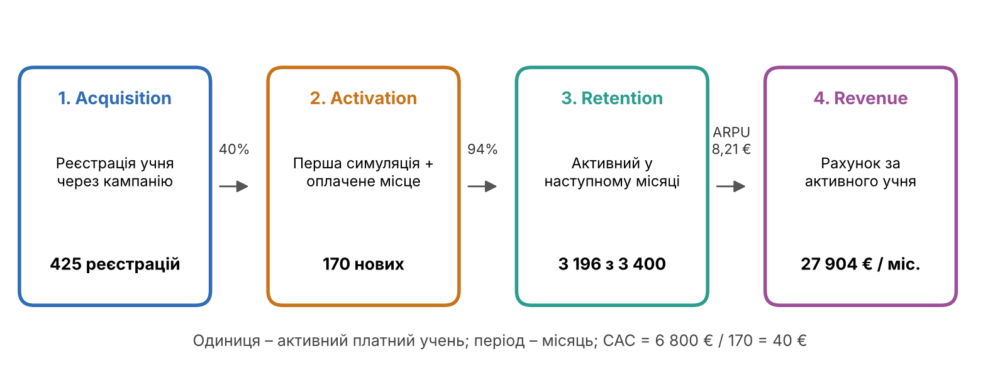
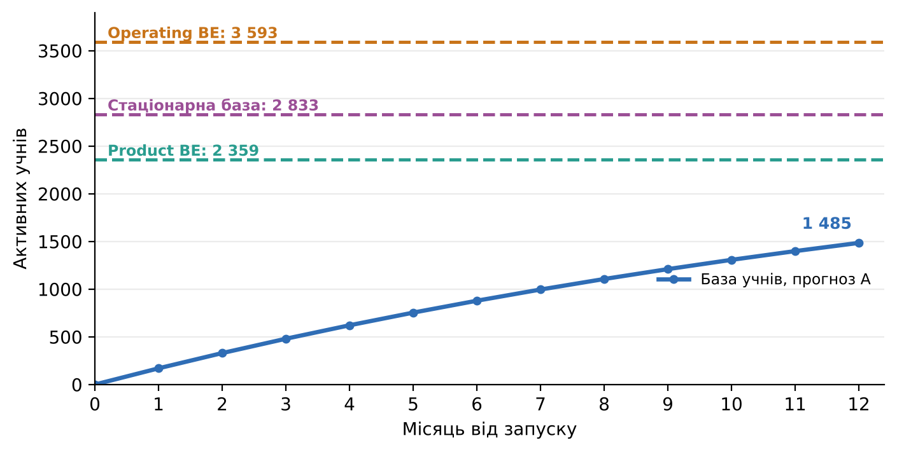

# ЛР 5. Unit economics і точка беззбитковості

> Дисципліна: «Економіка ПЗ» · Продукт: SafeStep (варіант 19) · КАІ, 2026  
> Оригінал звіту: [`lr5-unit-economics-break-even.docx`](../../reports/software-economics/lr5-unit-economics-break-even.docx)

## 1. Вхідні дані, визначення та власні припущення

ЛР № 5 перевіряє, чи масштабується модель **hybrid base + usage** з ЛР № 4 за продуктовими метриками. Валюта – євро, період – місяць. **Одиниця обліку – активний платний учень** (pricing metric ЛР № 4); у всіх знаменниках (CAC, ARPU, churn, breakeven) використано саме учнів, а не клієнтські акаунти чи транзакції. **Активний платний учень** – учень, який у місяці завершив щонайменше одну симуляцію і має оплачене місце. **Новий клієнт** – такий учень, який став активним платним уперше.

Задано варіантом 19: acquisition spend 6 800 €/міс.; нових клієнтів 170/міс.; monthly logo churn 6% (0,06); fixed OPEX 13 000 €/міс.; масштаб Y3 – 3 400 активних учнів. З ЛР № 4 і № 3 взято: revenue 27 904 €/міс. (40 клієнтів × 209 + 16 × 649 + 4 × 2 290 €), COGS 7 770 €/міс. (1,70 € × 3 400 + підтримка 1 990 €), тобто ARPU 8,21 €, gross margin 72,2%. Fixed OPEX не містить підтримки, бо її вже враховано в COGS; це унеможливлює подвійний облік.

**Таблиця 0. Власні припущення (не є перевіреними ринковими фактами)**

| № | Припущення                           | Значення   | Обґрунтування                                                                                                         |
|-------|------------------------------------------|----------------|---------------------------------------------------------------------------------------------------------------------------|
| A1    | Верх воронки: реєстрації учнів на місяць | 425            | Підібрано так, щоб за A2 вийшло задані 170 нових; вартість реєстрації = 6 800 / 425 = 16 €                                |
| A2    | Activation rate                          | 40%            | Навчальна оцінка частки зареєстрованих, які проходять першу симуляцію й отримують оплачене місце; перевіряється на пілоті |
| A3    | Змінні витрати поза COGS                 | 5% від revenue | Комісії платежів і партнерська винагорода; у COGS ЛР № 4 не входили; дає 0,41 € на учня                                   |
| A4    | ARPU учнів, що пішли (технічне)          | = середній     | Тому gross revenue churn дорівнює logo churn; для hybrid-тарифу це спрощення (див. розділ 3)                              |

## 2. Воронка

**Таблиця 1. Воронка і визначення подій (базовий місяць)**

| Етап    | Подія                                                         | Кількість | Конверсія | Джерело / припущення             |
|-------------|-------------------------------------------------------------------|---------------|---------------|--------------------------------------|
| Acquisition | Реєстрація учня через кампанію                                    | 425           | \-            | A1; вартість реєстрації 16 €         |
| Activation  | Перша завершена симуляція + оплачене місце (новий платний клієнт) | 170           | 40%           | A2; збігається з 170 нових (варіант) |
| Retention   | Учень активний наступного місяця (база на початок 3 400)          | 3 196         | 94%           | 1 − churn 6% (варіант); пішли 204    |
| Revenue     | Платний активний учень, за якого виставлено рахунок               | 3 400         | \-            | Масштаб Y3; revenue 27 904 €         |

Retention і Revenue – стани бази (3 400 на початок місяця), а Acquisition і Activation – потоки нових учнів, тому їхні кількості не утворюють єдиного «лійкового» спаду. База на кінець місяця – 3 366 (3 400 − 204 + 170): за 170 нових і churn 6% масштаб Y3 не утримується, для цього потрібно 204 нових на місяць.

## 3. Unit economics, churn, LTV і payback

**Таблиця 2. Unit economics (базовий місяць, масштаб Y3)**

| Метрика                      | Формула                                            | Значення | Період / одиниця           |
|----------------------------------|--------------------------------------------------------|--------------|--------------------------------|
| CAC                              | 6 800 / 170                                            | 40,00        | € на нового учня               |
| ARPU                             | Revenue / середня база = 27 904 / 3 400                | 8,21         | € на учня на міс.              |
| Gross margin                     | (Revenue − COGS) / Revenue = (27 904 − 7 770) / 27 904 | 72,2%        | частка від revenue             |
| Contribution margin              | ARPU − COGS − інші змінні = 8,21 − 2,29 − 0,41         | 5,51 (67,2%) | € на учня на міс.              |
| Logo churn / gross revenue churn | 204 / 3 400; (204 × 8,21) / 27 904                     | 6,0% / 6,0%  | на місяць, від бази на початок |
| LTV (просте)                     | ARPU × GM / churn = 8,21 × 0,7215 / 0,06               | 98,70        | € на учня                      |
| LTV / CAC                        | 98,70 / 40,00                                          | 2,47         | ×                              |
| CAC payback                      | CAC / gross profit на учня = 40 / 5,92                 | 6,8          | місяців                        |

**Gross margin і contribution margin.** GM 72,2% вища за CM 67,2%: CM додатково враховує змінні витрати поза COGS (A3). LTV і payback у таблиці 2 розраховано на gross profit за формулами методички; на contribution margin вони складають 91,86 €, LTV/CAC 2,30 і payback 7,3 міс. Break-even нижче розраховано послідовно на contribution margin.

**Churn.** Logo churn рахується від учнів на початок місяця: 3 400 × 0,06 = 204. За A4 gross revenue churn дорівнює logo churn; expansion revenue не віднімається. **Ризик простої LTV:** вона припускає сталі ARPU, маржу й churn і не враховує дисконтування; за churn 6% очікуваний термін життя ≈ 16,7 міс., а LTV/CAC = 2,47 \< 3. Крім того, у hybrid-моделі платять клієнти-організації, тому churn учнів усередині клієнта не обов’язково зменшує базову плату; потрібен когортний облік у пілоті.

## 4. Break-even і прогноз на 12 місяців

**Таблиця 3. Break-even**

| Показник                  | Формула / припущення                                 | Результат                                             |
|-------------------------------|----------------------------------------------------------|-----------------------------------------------------------|
| Contribution margin per unit  | ARPU − COGS на учня − інші змінні (A3)                   | 5,51 €                                                    |
| Fixed product OPEX            | Варіант 19                                               | 13 000 €/міс.                                             |
| Регулярний acquisition spend  | Повторюється щомісяця (варіант 19)                       | 6 800 €/міс.                                              |
| Product break-even units      | 13 000 / 5,51                                            | 2 359 учнів                                               |
| Operating break-even units    | (13 000 + 6 800) / 5,51                                  | 3 593 учнів                                               |
| Break-even revenue            | Fixed / CM ratio 67,2%; (Fixed + acquisition) / CM ratio | product 19 358 €; operating 29 484 €/міс.                 |
| Результат прогнозу 12 місяців | Customers_t = Customers\_{t−1} × 0,94 + 170; старт з 0   | обидві межі не досягнуто; база 1 485 = 63% від product BE |

Прогноз почато із запуску (0 клієнтів). Наприкінці 12-го місяця база – 1 485 учнів, тож **product break-even (2 359) і operating break-even (3 593) у межах 12 місяців не досягнуто**. Стаціонарна база за формулою нові / churn = 170 / 0,06 = 2 833 учнів: product break-even розрахунково досягається на 29-му місяці (поза горизонтом), а **operating break-even не досягається ніколи**, бо 2 833 \< 3 593. Operating break-even потребував би churn ≤ 4,73% за незмінного acquisition spend. На зрілій базі Y3 (3 400) запас до product BE становить 31%, але до operating BE бракує 193 учнів (5,7%), місячний результат −1 061 €. Місяць break-even – це перший місяць, коли contribution margin покриває відповідні постійні витрати; він не є строком окупності початкових інвестицій.

## 5. Однофакторна чутливість ±20%

**Таблиця 4. Матриця чутливості (змінюється один параметр, решта базові)**

<table>
<colgroup>
<col style="width: 12%" />
<col style="width: 19%" />
<col style="width: 19%" />
<col style="width: 19%" />
<col style="width: 29%" />
</colgroup>
<thead>
<tr class="header">
<th><strong>Фактор</strong></th>
<th><strong>−20%</strong></th>
<th><strong>База</strong></th>
<th><strong>+20%</strong></th>
<th><strong>Що змінилося</strong></th>
</tr>
</thead>
<tbody>
<tr class="odd">
<td>Churn</td>
<td>
4,8%

LTV/CAC 3,08

product BE: міс. 23
</td>
<td>
6,0%

LTV/CAC 2,47

product BE: міс. 29
</td>
<td>
7,2%

LTV/CAC 2,06

product BE: міс. 93
</td>
<td>LTV/CAC; місяць BE (з нуля, розрахунково, усі поза 12 міс.; operating BE не досягається в жодному випадку)</td>
</tr>
<tr class="even">
<td>Ціна (ARPU)</td>
<td>
6,57 €

LTV/CAC 1,78

BE: 3 289 / 5 010
</td>
<td>
8,21 €

LTV/CAC 2,47

BE: 2 359 / 3 593
</td>
<td>
9,85 €

LTV/CAC 3,15

BE: 1 839 / 2 800
</td>
<td>LTV/CAC; BE units (product / operating); COGS на учня незмінний (2,29 €)</td>
</tr>
<tr class="odd">
<td>CAC</td>
<td>
32,00 €

LTV/CAC 3,08

payback 5,4 міс.
</td>
<td>
40,00 €

LTV/CAC 2,47

payback 6,8 міс.
</td>
<td>
48,00 €

LTV/CAC 2,06

payback 8,1 міс.
</td>
<td>LTV/CAC; payback. Product BE = 2 359 без змін</td>
</tr>
</tbody>
</table>

**Ціна** – найсильніший драйвер break-even: product BE змінюється з 2 359 до 3 289 (−20%) або 1 839 учнів (+20%), а operating BE за +20% падає до 2 800 і стає нижчим за стаціонарну базу 2 833 (за −20% зростає до 5 010). **Churn і CAC** однаково змінюють LTV/CAC (3,08 / 2,06), оскільки LTV/CAC ∝ 1/(churn × CAC). Зміна CAC не змінює product BE; operating BE зміниться лише якщо CAC змінює acquisition spend (3 346 / 3 839 учнів за spend = CAC × 170). Для ціни припущено незмінний COGS; вплив ціни на попит окремо не моделювалося.

## 6. Рекомендація та відповіді на контрольні запитання

Найсильніший драйвер беззбитковості в моделі – **ціна (ARPU)**, а LTV/CAC однаково залежить від churn і CAC. За даних варіанта unit economics позитивна (gross margin 72,2%, CAC payback 6,8 міс.), але LTV/CAC = 2,47 нижче орієнтира 3. Запас до **product break-even** на масштабі Y3 становить 31% (3 400 проти 2 359), проте до **operating break-even** (3 593) бракує 5,7%, а за 170 нових на місяць база стабілізується на 2 833 і operating BE не досягається. Із запуску за 12 місяців база становить лише 1 485 учнів (63% від product BE). Ризик простої LTV: churn 6% відносно високий (середній термін життя ≈ 16,7 міс.), а revenue в hybrid-моделі залежить від клієнтів-організацій, тому оцінку треба підтвердити когортами. **Управлінська дія:** до збільшення бюджету залучення провести пілот утримання (онбординг, нагадування, звіти керівникам) із метою churn ≤ 4,7% і лише після цього масштабувати залучення та переглядати ціну.

## Відповіді на контрольні запитання

1.  **Logo churn і revenue churn.** Logo churn – частка втрачених клієнтів від клієнтів на початок місяця; gross revenue churn – частка втраченого й скороченого recurring revenue від revenue на початок. Вони збігаються лише коли пішли клієнти зі середнім ARPU і немає скорочень; у цій роботі збіг заданий припущенням A4 (6,0%).

2.  **Коли проста LTV некоректна.** Коли ARPU, маржа або churn нестабільні чи високі, коли немає стабільних акаунтів (transaction-based), коли когорти різко відрізняються, а також без дисконтування. Тут churn 6% і ARPU залежить від клієнта-організації, тому LTV 98,70 € – лише орієнтир.

3.  **Драйвер break-even.** Ціна: ±20% змінює product BE на +39% / −22% (3 289 / 1 839 учнів). Churn і CAC на product BE не впливають; churn визначає лише швидкість наближення до нього.

4.  **Чому GM може бути вищою за CM.** Gross margin враховує лише COGS, а contribution margin – усі змінні витрати, зокрема комісії платежів. Тут GM 72,2% \> CM 67,2% через A3 (5% revenue).

5.  **Операційний break-even і окупність інвестицій.** Operating break-even – місячна межа, за якої contribution margin покриває fixed OPEX і регулярний acquisition spend. Окупність інвестицій – накопичене повернення початкових вкладень (cost baseline MVP 86 572 € із ЛР № 3); вона настає пізніше й потребує додатного місячного результату протягом кількох місяців.

6.  **Чому зміна CAC не завжди змінює break-even units.** Product BE = fixed OPEX / CM не містить CAC. Operating BE залежить від CAC лише тоді, коли змінюється acquisition spend; якщо CAC падає за рахунок кращої конверсії за незмінного spend, BE units не змінюються.
