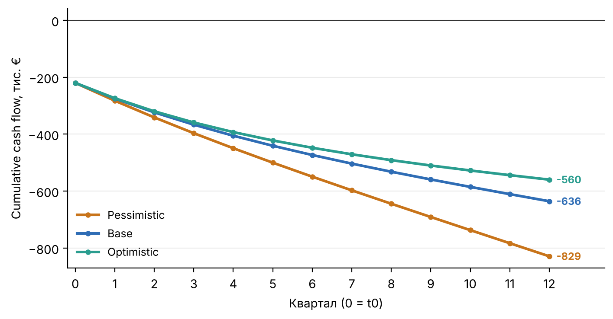

# ЛР 6. Грошові потоки та інвестиційна ефективність

> Дисципліна: «Економіка ПЗ» · Продукт: SafeStep (варіант 19) · КАІ, 2026  
> Оригінал звіту: [`lr6-cash-flow-npv.docx`](../../reports/software-economics/lr6-cash-flow-npv.docx)

## 1. Вхідні дані, конвенції та припущення

Модель оцінює інвестицію в SafeStep на 12 кварталів у євро. **Конвенція часу:** CF₀ виникає в момент t0 (запуск), потоки Q1–Q12 – наприкінці відповідного кварталу; однакова для всіх сценаріїв. Фінансування позикою до project cash flow не входить. **Заданий варіантом 19:** initial investment (CF₀) = 220 000 €, річна ефективна ставка 24%. Операційну частину взято з ЛР № 3–5: ARPU 8,21 €, COGS 2,29 € на учня, 170 нових учнів і churn 6% на місяць, fixed OPEX 13 000 €/міс., acquisition spend 6 800 €/міс., інші змінні витрати 5% від revenue. Клієнтська база: Customers_t = Customers\_{t−1} × 0,94 + 170, старт з 0 у момент t0; наприкінці Q4 – 996 і наприкінці Q12 – 1 485 учнів, як у ЛР № 5.

**Цей cash flow не дорівнює прибутку.** Revenue нараховується в місяці надання послуги, але частина грошей надходить пізніше (A1); CAPEX у прибуток не входить, але є грошовим відтоком; податки й ΔWC прийнято нульовими (A3).

## Узгодження initial investment з бюджетом MVP

Бюджет MVP із ЛР № 3 – 86 572 €, initial investment – 220 000 €. Різницю 133 428 € показано окремо, а не приховано зміною стартового параметра. Статті понад MVP – власні припущення (передопераційні разові витрати); вони не дублюють щоквартальні OPEX і acquisition spend.

**Таблиця 0. Узгодження initial investment (€)**

| Стаття                                                                  | €       | Частка |
|-----------------------------------------------------------------------------|-------------|------------|
| Бюджет MVP (cost baseline, ЛР № 3)                                          | 86 572      | 39,4%      |
| Аудит безпеки / pentest, юридична перевірка і захист даних (припущення)     | 20 000      | 9,1%       |
| Бібліотека сценаріїв симуляцій і локалізація (припущення)                   | 35 000      | 15,9%      |
| Передзапускове виведення на ринок: пілоти, матеріали, партнери (припущення) | 30 000      | 13,6%      |
| Разове налаштування інфраструктури та інтеграцій (припущення)               | 18 000      | 8,2%       |
| Резерв на ризики (залишок)                                                  | 30 428      | 13,8%      |
| Разом = initial investment (CF₀)                                        | 220 000 | 100,0% |

## 2. Ставка дисконтування

Взято ефективну річну ставку варіанта **24%** (діапазон завдання 12–30%). Це верхня частина діапазону, що відповідає ризику: продукт нового ринку без історії продажів, одна продуктова лінія, високий churn 6% на місяць, а activation rate і верх воронки – власні припущення. Квартальна **ефективна** ставка: r_q = 1,24^(1/4) − 1 = **5,525%**. Ділити 24% на 4 (6%) не можна, бо ставка ефективна, а не номінальна: (1,06)⁴ − 1 = 26,2% ≠ 24%.

## 3. Квартальний cash flow (Base)

**Таблиця 1. Квартальний cash flow, тис. € (Base; відтоки подано додатними числами; Optimistic і Pessimistic – у workbook)**

| Показник, тис. €    | t0     | Q1    | Q2    | Q3    | Q4    | Q5    | Q6    | Q7    | Q8    | Q9    | Q10   | Q11   | Q12   |
|-------------------------|------------|-----------|-----------|-----------|-----------|-----------|-----------|-----------|-----------|-----------|-----------|-----------|-----------|
| Cash inflows            | 0          | 7,2       | 17,5      | 26,3      | 33,7      | 39,8      | 44,9      | 49,1      | 52,6      | 55,5      | 57,9      | 59,9      | 61,6      |
| Operating cash outflows | 0          | 62,0      | 66,1      | 69,5      | 72,5      | 75,1      | 77,3      | 79,3      | 81,1      | 82,6      | 84,1      | 85,4      | 86,6      |
| CAPEX / taxes / ΔWC     | 220,0      | 0         | 0         | 0         | 0         | 0         | 0         | 0         | 0         | 0         | 0         | 0         | 0         |
| Net cash flow       | −220,0 | −54,8 | −48,6 | −43,2 | −38,8 | −35,3 | −32,5 | −30,2 | −28,5 | −27,1 | −26,2 | −25,4 | −25,0 |
| Cumulative cash flow    | −220,0     | −274,8    | −323,4    | −366,6    | −405,5    | −440,7    | −473,2    | −503,4    | −531,9    | −559,1    | −585,2    | −610,7    | −635,6    |

Cash inflows нижчі за revenue, бо 10% виручки кварталу надходить у наступному (A1): у Q12 revenue 61 750 €, а cash inflows 61 587 €. Operating cash outflows складаються з COGS, інших змінних витрат, fixed OPEX і acquisition spend; постійні витрати індексуються на 1% за квартал (A2). Рядок CAPEX / taxes / ΔWC містить лише CF₀ = −220 тис. €, бо податки й ΔWC прийнято нульовими.

## 4. Показники та сценарії

**Base** відтворює прогноз ЛР № 3–5. **Optimistic:** cash inflows +15%. **Pessimistic:** cash inflows −20% і operating cash outflows +10%. Інші припущення не змінюються. NPV = CF₀ + Σ CF_t/(1 + r_q)^t, t = 1…12, тож CF₀ не віднімається вдруге.

**Таблиця 2. Інвестиційні показники (r = 24% річних; квартальна одиниця часу)**

| Сценарій | ROI | PP       | DPP      | NPV, € | IRR annual | Рішення |
|--------------|---------|--------------|--------------|------------|----------------|-------------|
| Pessimistic  | −67,2%  | не досягнуто | не досягнуто | −664 772   | не існує       | Stop        |
| Base         | −55,7%  | не досягнуто | не досягнуто | −532 605   | не існує       | Stop        |
| Optimistic   | −49,0%  | не досягнуто | не досягнуто | −482 152   | не існує       | Stop        |

**ROI** = (Σ cash inflows − Σ cash outflows) / Σ cash outflows: у Base (505 913 − 1 141 538) / 1 141 538 = −55,7%, без дисконтування. **PP і DPP** не досягнуто на горизонті моделі: cumulative cash flow на Q12 дорівнює −635 625 € (Base), і жодного кварталу з додатним net cash flow немає; PP і DPP не екстраполюються. **IRR не існує**, бо всі потоки від’ємні й знак не змінюється; рішення тому приймається за NPV. За ставок 12% і 30% NPV Base – −576 214 і −514 942 €, тож вибір ставки висновок не змінює.

## 5. Рішення: Stop

**Рішення – Stop** за поточної конфігурації: base NPV = −532 605 €, а навіть Optimistic NPV = −482 152 €, тобто сценарій із cash inflows +15% не створює прийнятної вартості. Причина – не розмір інвестиції, а операційна економіка: net cash flow від’ємний у **кожному** кварталі, бо за 170 нових учнів на місяць база наближається до 2 833 учнів, що нижче operating break-even 3 593 з ЛР № 5. Перевірка: за CF₀ = 0 NPV Base усе одно −312 605 €.

**Чому не Pivot.** Одна визначена зміна, що відновлює NPV, відсутня. Зменшення інвестиції не допомагає (див. вище). За незмінних churn, CAC і COGS NPV Base = 0 лише за ARPU ≈ **21,90 €** на учня на місяць (×2,67 до поточних 8,21 €), що не підтверджено жодним тарифним аналізом ЛР № 4. Тому проєкт у поточній формі не фінансувати; Pivot доцільно розглядати лише за умовами нижче.

## Умови перегляду

1.  **Підтверджена ціна.** Якщо пілотні когорти (щонайменше два квартали) покажуть ARPU ≥ 21,90 €/учня за незмінних churn 6%, CAC 40 € і COGS на учня, модель треба перерахувати й розглянути Pivot (новий тариф або сегмент).

2.  **Відхилення від плану.** Якщо cash inflows або operating cash outflows у Q2 відхиляються від плану (17 452 € і 66 070 €) більш ніж на 15%, NPV і сценарії перераховують, а рішення переглядають.

## 6. Журнал припущень і відповіді на контрольні запитання

**Таблиця 3. Журнал припущень**

| ID | Припущення                                  | Base                                   | Optimistic | Pessimistic | Підстава                                                      |
|--------|-------------------------------------------------|--------------------------------------------|----------------|-----------------|-------------------------------------------------------------------|
| A1     | Cash inflows                                    | 100%                                       | 115%           | 80%             | умова роботи                                                      |
| A2     | Operating cash outflows                         | 100%                                       | 100%           | 110%            | умова роботи                                                      |
| A3     | Податки / ΔWC                                   | 0                                          | 0              | 0               | власне припущення: збиткова модель, відстрочку враховано через A4 |
| A4     | Частка виручки, що надходить грошима в кварталі | 90%                                        | 90%            | 90%             | власне припущення; 10% надходить наступного кварталу              |
| A5     | Зміна operating cash cost                       | +1% за квартал на fixed OPEX і acquisition | так само       | так само        | власне припущення (≈ +4,1% на рік)                                |
| A6     | Ставка / CF₀                                    | 24%; 220 тис. €                            | так само       | так само        | варіант 19                                                        |

## Відповіді на контрольні запитання

1.  **Прибуток і cash flow.** Прибуток враховує нарахування й амортизацію, але не CAPEX, відстрочки платежів і зміни working capital. Тут revenue Q12 = 61 750 €, а cash inflows 61 587 €; CAPEX 220 тис. € у прибуток не потрапляє, але є грошовим відтоком.

2.  **Вибір discount rate.** Взято ставку варіанта 24% (діапазон 12–30%) як відображення ризику нового продукту без історії; r_q = 1,24^(1/4) − 1 = 5,525%.

3.  **NPV проти IRR.** NPV дає абсолютну вартість у євро й не залежить від масштабу та кількох змін знака; IRR – відносний показник, може бути неоднозначним і не порівнює проєкти різного розміру. Тут IRR не існує, тому рішення тримається на NPV.

4.  **Чому CF₀ додають окремо.** Функція NPV дисконтує перше значення діапазону за t = 1; CF₀ у t0 не дисконтується, тому формула – CF₀ + NPV(r_q; Q1:Q12). Якщо CF₀ потрапить у діапазон, його буде помилково продисконтовано.

5.  **PP і DPP.** PP – перший квартал, коли накопичений недисконтований потік ≥ 0; DPP – те саме за дисконтованими потоками, тому DPP ≥ PP. Обидва в кварталах; тут обидва не досягнуто на горизонті.

6.  **Коли IRR вводить в оману.** За кількох змін знака потоків (можливі кілька IRR), за відсутності зміни знака (як тут – IRR не існує), при порівнянні взаємовиключних проєктів різного масштабу; квартальну IRR слід приводити до річної (1 + IRR_q)⁴ − 1 перед порівнянням зі ставкою.
