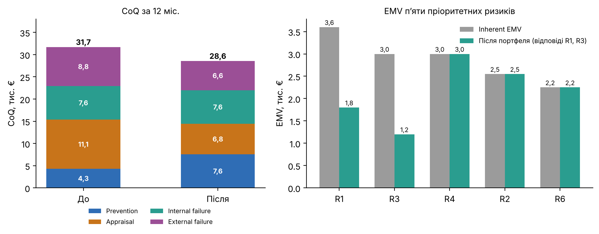

# ЛР 7. Економіка якості, ризиків і технічного боргу

> Дисципліна: «Економіка ПЗ» · Продукт: SafeStep (варіант 19) · КАІ, 2026  
> Оригінал звіту: [`lr7-quality-risk-tech-debt.docx`](../../reports/software-economics/lr7-quality-risk-tech-debt.docx)

## 1. Вхідні дані, горизонт і межі розрахунку

Робота продовжує SafeStep (варіант 19, hybrid base + usage, метрика – учень). **Горизонт оцінювання – перші 12 місяців після релізу**, валюта – євро; усі складові (витрати, вигоди, ризики, борг) відносяться до цього самого періоду. З варіанта 19: **30 regression cycles на рік** і **loaded QA rate 45 €/год**. Зверніть увагу: у ЛР № 3 QA оцінено у 3 800 €/міс. (≈ 21,9 €/год), тому ставку 45 €/год застосовано лише як задану варіантом; ставки Developer (30,0 €/год), BA/PM (24,2 €/год) і DevOps (31,7 €/год) розраховано з ЛР № 3 діленням місячної ставки на 173,3 год.

**Ліміт заходів.** Базою взято cost baseline MVP з ЛР № 3 – 86 571,73 € (base estimate + contingency; management reserve 6 634 € не входить). Ліміт додаткових заходів контролю = 10% = **8 657,17 €**. Дохід перших 12 місяців – 88 117 € (ЛР № 6, Base).

**Таблиця 0. Власні припущення**

| № | Припущення                 | Значення                                                                                                                              | Підстава                                                                                                         |
|-------|--------------------------------|-------------------------------------------------------------------------------------------------------------------------------------------|----------------------------------------------------------------------------------------------------------------------|
| A1    | Базовий рівень зовнішніх збоїв | 10 production-інцидентів на рік; витрати на інцидент (8 год Developer, 3 год QA, 1 год BA/PM + знижка 300 €) і service credits 2% revenue | Навчальна оцінка для нового продукту; порівнянна з L3-підтримкою Developer 0,2 FTE у ЛР № 3; перевіряється на пілоті |
| A2    | Ефективність заходів           | Автоматизація усуває 25% зовнішніх збоїв; параметри response для ризиків – у таблиці 3                                                    | Широке й частіше регресійне покриття; навчальна оцінка, не ринковий факт                                             |

**Уникнення подвійного обліку.** Кожну втрату враховано в одному основному місці: регулярні production-збої та service credits – лише в CoQ (external failure); поодинокі події – лише в risk register (EMV); додаткова робота над плановими змінами через борг – лише в debt interest. CoQ – класифікація витрат, а не додатковий бюджет: частину E1 уже містить ЛР № 3 (support Developer).

## 2. Cost of Quality

**Таблиця 1. Cost of Quality за 12 місяців**

| Категорія            | Стаття                                                                         | Річна сума, € | Підстава                                                                 |
|--------------------------|------------------------------------------------------------------------------------|-------------------|------------------------------------------------------------------------------|
| Prevention               | P1 Code review і secure-design перевірки                                           | 2 700             | 3 год Developer × 30 циклів × ставка Developer                               |
| Prevention               | P2 Етична/приватнісна перевірка нових шаблонів + юрист                             | 1 582             | 24 год BA/PM × ставка + 1 000 € консультація                                 |
| Appraisal                | A1 Ручне виконання regression (30 циклів)                                          | 10 328            | Σ manual h/цикл × 30 × 45 €/год                                              |
| Appraisal                | A2 Сканування безпеки і розбір результатів                                         | 762               | 24 год DevOps × ставка DevOps                                                |
| Internal failure         | I1 Виправлення та повторне тестування дефектів, знайдених у циклах                 | 6 188             | 30 циклів × 2,5 дефекти × (2 год Dev + 0,5 год QA)                           |
| Internal failure         | I2 Повторні запуски циклу через збій збірки/середовища                             | 1 377             | 4 запуски × Σ manual h/цикл × 45 €/год                                       |
| External failure         | E1 Production-інциденти: виправлення, повторна перевірка, комунікація, компенсація | 6 992             | A1: 10 інцидентів; частина LR3 Support (Developer L3), тут лише класифікація |
| External failure         | E2 Service credits клієнтам                                                        | 1 762             | A1: 2% revenue перших 12 міс. (ЛР № 6)                                       |
| CoQ                  | Σ чотирьох категорій                                                           | 31 690        | Prevention 4 282 + Appraisal 11 089 + Internal 7 565 + External 8 755    |
| Cost of Poor Quality | Internal + external failure                                                    | 16 319        | 51,5% від CoQ                                                            |

CoQ становить **31 690 €**, з них Cost of Poor Quality – **16 319 €** (51,5%). Найбільша стаття – ручне виконання regression (A1 = 10 328 €), тому автоматизація зачіпає саме її. Opportunity loss (відтік клієнтів через інциденти) не рахується: це не підтверджені грошові витрати.

## 3. Автоматизація 10 regression-сценаріїв

Пакет T1–T10 покриває функції F1–F10 з ЛР № 1 (склад і часи – додаток А). Manual cost avoided = 30 × (7,65 − 1,21) × 45 = **8 694 €**. Automation cost = build 2 700 € (60 год) + maintenance 1 350 € (1 год на цикл) + tooling 400 € = **4 450 €**. Expected failure loss reduction = 25% × 8 755 € = 2 189 € (A2).

**Таблиця 2. Пакет автоматизації 10 сценаріїв**

| Сценарії | Σ manual h/cycle | Build h | Maint. h/year | Σ review h/cycle | Cycles | Suite ROI |
|--------------|----------------------|-------------|-------------------|----------------------|------------|---------------|
| T1–T10       | 7,65                 | 60          | 30                | 1,21                 | 30         | 144,6%        |

**Suite ROI = (8 694 + 2 189 − 4 450) / 4 450 = 144,6%**; net benefit 6 433 €. Без failure loss reduction вигода від одного циклу (6,44 год × 45 €) покриває build і tooling за ≈ 12,7 циклу на рік; нижче цього автоматизація економічно невигідна.

## 4. Ризики

**Таблиця 3. Risk register (12 ризиків)**

| ID | Ризик                                       | Owner | Probability | Impact, € | Inherent EMV, € | Top 5 |
|--------|-------------------------------------------------|-----------|-----------------|---------------|---------------------|-----------|
| R1     | Етична скарга на шаблони симуляцій              | BA/PM     | 0,30            | 12 000        | 3 600               | так       |
| R2     | Вимога DPO змінити модель даних F7–F9           | BA/PM     | 0,25            | 10 200        | 2 550               | так       |
| R3     | Витік/неавторизований доступ до журналу подій   | DevOps    | 0,05            | 60 000        | 3 000               | так       |
| R4     | Вразливість вебпорталу (XSS/IDOR)               | Developer | 0,15            | 20 000        | 3 000               | так       |
| R5     | Тривала недоступність cloud понад SLA           | DevOps    | 0,20            | 9 000         | 1 800               |           |
| R6     | Втрата ключового розробника                     | BA/PM     | 0,15            | 15 000        | 2 250               | так       |
| R7     | Провайдери позначають листи як спам (F4)        | DevOps    | 0,35            | 6 000         | 2 100               |           |
| R8     | Помилка офлайн-синхронізації F10                | Developer | 0,20            | 8 000         | 1 600               |           |
| R9     | Хибна ескалація SOC клієнта                     | QA        | 0,30            | 4 000         | 1 200               |           |
| R10    | Зміна ліцензії стороннього компонента           | BA/PM     | 0,10            | 7 000         | 700                 |           |
| R11    | Помилка ролей: керівник бачить персональні дані | Developer | 0,15            | 14 000        | 2 100               |           |
| R12    | Нестача QA-ресурсу в піки                       | QA        | 0,25            | 3 000         | 750                 |           |
|        | Σ inherent EMV                              |           |                 |               | 24 650          |           |

**Таблиця 3 (продовження). Residual analysis п’яти пріоритетних ризиків**

| ID | Response                                                                                                          | Cost, € | p після | Impact після, € | Residual EMV, € | Net benefit, € |
|--------|-----------------------------------------------------------------------------------------------------------------------|-------------|-------------|---------------------|---------------------|--------------------|
| R1     | Чек-лист етичної перевірки і публікація шаблонів лише після двох рецензентів                                          | 700         | 0,15        | 12 000              | 1 800               | 1 100              |
| R3     | Шифрування, журнал доступів, RBAC-аудит і pentest доступу до журналу подій (обов’язковий security/compliance control) | 2 600       | 0,03        | 40 000              | 1 200               | −800               |
| R4     | SAST/DAST і сканування залежностей у CI                                                                               | 1 500       | 0,06        | 20 000              | 1 200               | 300                |
| R2     | Ранній огляд моделі даних з DPO до перших клієнтів                                                                    | 900         | 0,10        | 8 000               | 800                 | 850                |
| R6     | Документація, парне програмування і передача знань                                                                    | 1 800       | 0,08        | 10 000              | 800                 | −350               |

Net benefit = inherent EMV − residual EMV − response cost (приклад R1: 3 600 − 1 800 − 700 = 1 100 €). Residual EMV не прирівнюється до нуля: відповіді лише знижують імовірність або наслідок. Для R3 і R6 вимірюваний net benefit від’ємний; R3 при цьому є обов’язковим security/compliance control.

## 5. Технічний борг

**Таблиця 4. Technical debt register**

| ID | Позиція боргу                                                               | Principal, € | Annual interest, € | Метрика                                                   | Payback, років |
|--------|---------------------------------------------------------------------------------|------------------|------------------------|---------------------------------------------------------------|--------------------|
| D1     | Журнал подій (F7) без версіонування схеми: кожна зміна потребує ручної міграції | 2 550            | 3 240                  | Год на одну зміну схеми: 12 год × 9 змін на рік               | 0,79               |
| D2     | Інтеграції пошта/SMS (F4) без контрактних тестів                                | 1 800            | 1 500                  | Год ручних перевірок після змін API провайдера: 50 год на рік | 1,20               |
| D3     | Текст шаблонів (F1) зашито в код, а не в каталог даних                          | 3 000            | 2 100                  | Розробницькі год на один контентний реліз: 7 год × 10 релізів | 1,43               |
| D4     | Модуль синхронізації офлайн-подій (F10): дублювання логіки                      | 2 700            | 1 200                  | Додаткові год на кожну зміну модуля: ≈ 4 год × 10 змін        | 2,25               |
| D5     | Ручні кроки розгортання та розбіжність конфігурацій середовищ                   | 1 999            | 1 809                  | Год ручного розгортання: ≈ 1,9 год × 30 релізів               | 1,11               |

Principal – разова вартість усунення, annual interest – додаткові години на планові зміни за 12 місяців (не плутати з principal). Простий payback = principal / avoided annual interest; він є орієнтиром і не враховує доступність команди. Найшвидше окупається D1 (0,79 року); у interest не входять інциденти (CoQ) і поодинокі ризики (R2, R5, R7, R8).

## 6. Портфель заходів і рішення

**Таблиця 5. План контролю (ліміт 8 657 €)**

| Захід                                                         | Тип                   | Cost, € | Cost reduction, € | Loss reduction, € | Net benefit, € | Select      |
|-------------------------------------------------------------------|---------------------------|-------------|-----------------------|-----------------------|--------------------|-----------------|
| M1 Автоматизація 10 regression-сценаріїв (T1–T10)                 | Appraisal / автоматизація | 4 450       | 8 694                 | 2 189                 | 6 433              | так             |
| M2 Контролі безпеки і приватності журналу подій (відповідь на R3) | Prevention / security     | 2 600       | 0                     | 1 800                 | −800               | так (mandatory) |
| M3 Чек-лист етичної перевірки шаблонів (відповідь на R1)          | Prevention                | 700         | 0                     | 1 800                 | 1 100              | так             |
| M4 Ранній DPO-огляд моделі даних (відповідь на R2)                | Prevention                | 900         | 0                     | 1 750                 | 850                | ні              |
| M5 Усунення боргу D1 (версіонування схеми журналу)                | Technical debt            | 2 550       | 3 240                 | 0                     | 690                | ні              |
| Разом вибрано                                                 |                           | 7 750   | 8 694             | 5 789             | 6 733          | 3 заходи    |

Вибрано **M1, M2, M3** на **7 750 €** (запас 907 €, net benefit **6 733 €**). Перебір усіх допустимих наборів із 2–3 заходів показав, що це найкращий набір, який містить обов’язковий M2. Без вимоги M2 кращим був би M1 + M3 + M4 (net benefit 8 383 €), тож ціна обов’язкового security-контролю – 1 650 € очікуваної вигоди. Усі складові стосуються одних і тих самих 12 місяців.

## Що виконується зараз, а що відкладається

- **Зараз:** M1 (автоматизація: найбільший net benefit, ROI 145%); M2 (контролі безпеки й приватності журналу подій: **обов’язковий security/compliance control**, включено попри від’ємний вимірюваний net benefit −800 €, бо R3 має impact 60 000 €, а EMV – лише очікуване значення); M3 (дешевий захід на R1).

- **Відкладається:** M4 (DPO-огляд, net +850 €) – не вміщується в обмеження 2–3 заходів, але R2 лишається під моніторингом; M5 (усунення D1, net +690 €, payback 0,79 року) – разом із M1–M3 перевищує ліміт; SAST/DAST для R4 (net +300 €) – наступний період; R6 – від’ємний net benefit, ризик приймається й відстежується.

## Відповіді на контрольні запитання

1.  **Prevention і failure cost.** Prevention – витрати до появи дефекту (review, перевірка шаблонів), failure cost – витрати на наслідки вже виниклих дефектів (виправлення, компенсації). Тут prevention 4 282 €, failure 16 319 €.

2.  **Коли автоматизація невигідна.** Коли циклів менше за точку беззбитковості (тут ≈ 12,7 циклу на рік без failure loss reduction), коли сценарії нестабільні й maintenance великий, або коли build + tooling більші за економію ручного часу.

3.  **Annual interest боргу.** Через додаткові години на планові зміни, які виникають через борг: кількість змін × додаткові год × ставка (D1: 9 змін × 12 год × 30 €/год = 3 240 €).

4.  **Inherent і residual EMV.** Inherent EMV – до response (p₀ × impact₀), residual – після (p₁ × impact₁); різниця мінус вартість response дає net benefit. Residual EMV не обнуляється автоматично.

5.  **Чому позитивний net benefit не обов’язковий до виконання.** Є ліміт бюджету й конкуренція заходів (M4 і M5 мають net benefit \> 0, але відкладені); мірою вибору є найкращий набір у межах 10% baseline. Навпаки, обов’язковий control (M2) виконують за від’ємного net benefit.

6.  **Подвійний облік.** Для кожної втрати визначити один основний розрахунок: регулярні збої – CoQ, поодинокі події – risk register, надлишкова робота на зміни – debt interest; у реєстрах позначити зв’язки (колонка «Де основний облік» у workbook).

## Додаток А. Склад пакета автоматизації T1–T10

| ID | Сценарій                                             | Функція | Manual, год/цикл | Review, год/цикл |
|--------|----------------------------------------------------------|-------------|----------------------|----------------------|
| T1     | Вхід через SSO та розмежування ролей (3 ролі)            | F3          | 0,60                 | 0,08                 |
| T2     | Створення кампанії: шаблон, група, розклад               | F1, F2      | 0,80                 | 0,10                 |
| T3     | Доставка симуляції (мітка, allowlist, домен)             | F4          | 1,00                 | 0,15                 |
| T4     | Журнал подій: click, submit, report, time-to-report      | F7          | 0,75                 | 0,10                 |
| T5     | Мікроурок після помилки (відкриття ≤ 2 с, зміст)         | F5          | 0,50                 | 0,08                 |
| T6     | Кнопка «Повідомити» і підтвердження                      | F6          | 0,50                 | 0,08                 |
| T7     | Дашборд: агрегація, групи \< 10 приховані                | F8          | 0,90                 | 0,12                 |
| T8     | Експорт звіту PDF/CSV                                    | F8          | 0,60                 | 0,08                 |
| T9     | Приватність: видалення даних, термін зберігання          | F9          | 0,80                 | 0,12                 |
| T10    | Офлайн-режим: черга і синхронізація без втрат/дублікатів | F10         | 1,20                 | 0,30                 |
| Σ  |                                                          |             | 7,65             | 1,21             |
