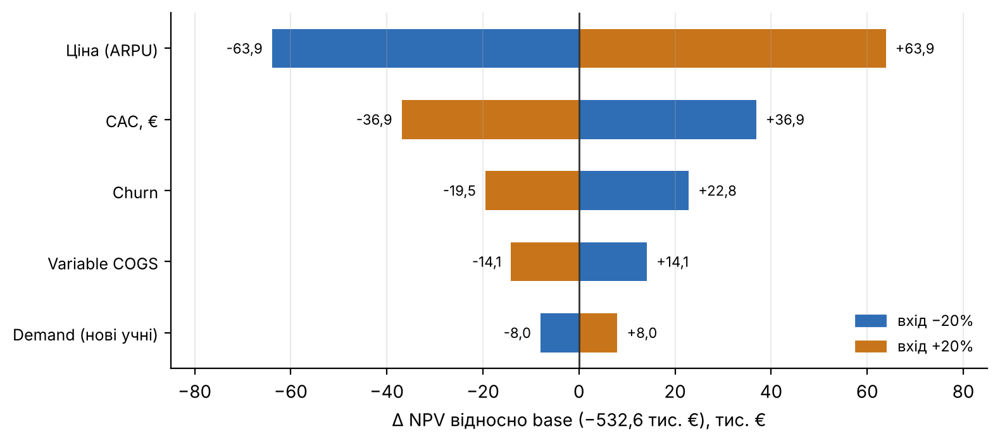

# ЛР 8. Сценарний аналіз і захист бізнес-кейсу

> Дисципліна: «Економіка ПЗ» · Продукт: SafeStep (варіант 19) · КАІ, 2026  
> Оригінал звіту: [`lr8-scenarios-business-case.docx`](../../reports/software-economics/lr8-scenarios-business-case.docx)

## Підсумок для інвестиційного комітету (one-page summary)

**Рішення: архітектура A (cloud); інвестицію 220 000 € за поточної конфігурації не схвалювати – STOP.** NPV base = −532 605 € (12 кварталів, r = 24%); усі три сценарії від’ємні. Проєкт переглядається за gates G1–G3.

| Показник                           | Значення                                   | Джерело      |
|----------------------------------------|------------------------------------------------|------------------|
| Scope; сегмент                         | MVP F1–F10; S1 (офісні працівники)             | ЛР № 1           |
| MVP: P50 / baseline; команда           | 122,5 / 130 роб. днів; 6 осіб, 3,75 FTE        | ЛР № 2           |
| Cost baseline MVP                      | 86 572 €                                       | ЛР № 3           |
| TCO3 cloud (оновлено) / on-premise     | 251 013 / 271 782 €                            | ЛР № 3, оновлено |
| ARPU; gross margin                     | 8,21 € на учня на міс.; 72,2%                  | ЛР № 4           |
| CAC; LTV/CAC; payback                  | 40 €; 2,47; 6,8 міс.                           | ЛР № 5           |
| Break-even (product / operating); база | 2 359 / 3 593; стаціонарна 2 833 учні          | ЛР № 5           |
| NPV base / Optimistic / Pessimistic    | −532 605 / −482 152 / −664 772 €               | ЛР № 6           |
| Головний драйвер NPV                   | ціна: range 127 718 €; NPV = 0 за ARPU 21,90 € | ЛР № 8           |
| Портфель заходів контролю              | 7 750 € (ліміт 8 657 €); M1, M2, M3            | ЛР № 7           |

**Три головні ризики (ЛР № 7):** R1 етична скарга на шаблони (EMV 3 600 €) → чек-лист етики; R3 витік журналу подій (3 000 €) → контролі безпеки, **обов’язковий security-control**; R4 вразливість порталу (3 000 €) → захід відкладено.

**KPI:** ARPU ≥ 21,90 €; activation ≥ 40%; logo churn ≤ 6%; база ≥ 1 262 учнів на 12-му міс.; net cash flow ≥ 0 з Q4.

**Умови перегляду:** G1 (8 тижнів) – пілотні пропозиції з ARPU ≥ 21,90 € і activation ≥ 40%; G2 (кінець Q2) – база ≥ 1 262, надходження Q2 у межах ±15% плану; G3 (кінець Q4) – додатний net cash flow. **Пілот має перевірити п’ять припущень:** ціну, CAC, churn, змінні витрати, попит (у порядку впливу на NPV).

## 1. Узгодженість даних

Валюта – євро, горизонт – 12 кварталів від запуску (t0–Q12), ставка 24% – як у ЛР № 6. Ланцюг трасованості: **scope** (F1–F10) → **effort** (122,5 роб. дня, 3,75 FTE) → **labor cost** (62 512 €) → **cost baseline** (86 572 €; частина CF0 = 220 000 €) → **price** (209 / 649 / 2 290 €; ARPU 8,21 €) → **demand** (170 нових на місяць, churn 6%) → **revenue** (Σ cash inflows Q1–Q12 = 505 913 €) → **cash flow** (cumulative Q12 = −635 625 €) → **NPV** (−532 605 €) → **decision** (stop).

**Таблиця 1. Перевірка узгодженості**

| Показник                         | Значення                                    | Джерело      | Період / одиниця | Пов’язаний показник |
|--------------------------------------|-------------------------------------------------|------------------|----------------------|-------------------------|
| Scope; сегмент                       | F1–F10 (вкл. офлайн F10); S1                    | ЛР № 1           | 10 функцій; учень    | Effort                  |
| Строк P50 / baseline                 | 122,5 / 130                                     | ЛР № 2           | роб. дні             | Labor cost              |
| Cost baseline MVP                    | 86 572                                          | ЛР № 3           | €                    | CF0 220 000 €           |
| TCO3 cloud / on-premise              | 251 013 / 271 782 (початково 291 257 / 271 782) | ЛР № 3, оновлено | € за 3 роки          | Вибір A/B               |
| Ціни Basic / Standard / Pro          | 209 / 649 / 2 290                               | ЛР № 4           | € на клієнта на міс. | ARPU                    |
| ARPU; GM                             | 8,21; 72,2%                                     | ЛР № 4–5         | € на учня на міс.    | Unit economics          |
| CAC; LTV/CAC; payback                | 40; 2,47; 6,8                                   | ЛР № 5           | €; ×; міс.           | Break-even              |
| Break-even product / operating; база | 2 359 / 3 593; 2 833                            | ЛР № 5           | учнів                | Demand                  |
| NPV base; CF0; r                     | −532 605; 220 000; 24%                          | ЛР № 6           | €; t0–Q12            | Decision                |
| Ризики R1, R3, R4; портфель          | EMV 3 600 / 3 000 / 3 000; 7 750 €              | ЛР № 7           | € за 12 міс.         | Не входить у NPV        |

## Виявлені розбіжності й прийняті рішення

- **Cloud operation.** У ЛР № 3 задано Y1 = 27 000 € ще до моделювання попиту, а в ЛР № 5–6 попит дає лише 10 736 customer-months у першому році. Обрано **актуальне значення – за попитом**: cloud-частка variable COGS 0,91 € на учня (звірка ЛР № 4: 54% від 1,70 €) → operation Y1 = 9 805 €. Оновлено лише залежне: TCO3 cloud 291 257 → **251 013 €**; MVP, support, change і TCO on-premise (потужність під Y3) не змінилися. Порядок TCO змінився на протилежний: початково on-premise дешевший на 19 476 €, тепер cloud дешевший на 20 769 €. NPV ЛР № 6 уже використовував попит, тому не змінюється.

- **Витрати LR7.** Портфель 7 750 € не входив у cash flow ЛР № 6. Із ними NPV base = −539 392 € (−6 787 €). Вигоди LR7 не додано, бо відповідні витрати теж не були в ЛР № 6 (уникнення завищення).

- **Ставка QA.** 45 €/год (ЛР № 7, варіант) відрізняється від 3 800 €/міс. (≈ 21,9 €/год, ЛР № 3). Вплив на NPV немає: ставка LR7 використана лише в розрахунках якості.

## 2. Порівняння альтернатив: cloud (A) і on-premise (B)

B – виділений сервер у ЄС із резервуванням (fixed hosting), потужність під навантаження Y3. Однакові для обох: scope F1–F10, горизонт три роки, SLA 99,5%, вимоги безпеки NFR3 (TLS 1.2+, AES-256), навантаження. Релевантні лише майбутні витрати, що відрізняються: start-up, operation, ризики, retirement; cost baseline MVP, support і change однакові й скорочуються, а вже виконана аналітична робота – sunk і не впливає на вибір. Шкала 1–5; **для TCO більша оцінка означає нижчі витрати** (5 – найнижчий TCO3, −1 бал за кожні повні 5% перевищення).

**Таблиця 2. Порівняння альтернатив (A – cloud, B – on-premise)**

| Критерій                                | Вага | A score | A weighted | B score | B weighted |
|---------------------------------------------|----------|-------------|----------------|-------------|----------------|
| 3-річний TCO (нижчі витрати = вища оцінка)  | 35%      | 5           | 1,75           | 4           | 1,40           |
| Time-to-market                              | 20%      | 5           | 1,00           | 3           | 0,60           |
| Контроль даних і безпека                    | 15%      | 3           | 0,45           | 5           | 0,75           |
| Масштабованість                             | 20%      | 5           | 1,00           | 3           | 0,60           |
| Ризик (SLA 99,5%, адміністрування, lock-in) | 10%      | 4           | 0,40           | 3           | 0,30           |
| Разом                                   | 100% |             | 4,60       |             | 3,65       |

Weighted score: **A = 4,60, B = 3,65**. 3-річний TCO: cloud 251 013 €, on-premise 271 782 €. NPV on-premise на 24 306 € гірший (start-up 30 000 € і постійна потужність за низького раннього попиту). **Стійкість вибору:** за початковим TCO3 ЛР № 3 (cloud дорожчий) оцінки TCO змінюються на 4 і 5, але A усе одно переважає: 4,25 проти 4,00. Обов’язкові обмеження (дані в ЄС, SLA 99,5%, шифрування, три ролі) виконують обидві альтернативи, тому вони не компенсуються балами. Недолік A – менший контроль даних; він знімається контролями R3 (розділ 5).

## 3. Сценарії та чутливість

**Таблиця 4. Три сценарії (перенесено з ЛР № 6)**

| Сценарій | Ключові входи                                 | Revenue (Σ cash inflows), € | Cash flow (cum. Q12), € | NPV, € |
|--------------|---------------------------------------------------|---------------------------------|-----------------------------|------------|
| Optimistic   | inflows ×1,15; outflows ×1; CF0 220 000 €; r 24%  | 581 800                         | −559 738                    | −482 152   |
| Base         | inflows ×1; outflows ×1; CF0 220 000 €; r 24%     | 505 913                         | −635 625                    | −532 605   |
| Pessimistic  | inflows ×0,8; outflows ×1,1; CF0 220 000 €; r 24% | 404 730                         | −828 962                    | −664 772   |

Сценарій одночасно змінює узгоджений набір входів. У всіх трьох NPV від’ємний, тому висновок не залежить від вибору сценарію.

## Sensitivity analysis (alternative A, decision metric – NPV)

Змінюється лише один безперервний параметр на −20% і +20%, решта – базові. Discrete-рішення (архітектура, склад команди) не змінювались. Для demand acquisition spend = CAC × нові клієнти (рухається разом із залученням); churn +20% означає гірше.

**Таблиця 3. Sensitivity table (NPV, €)**

| Драйвер                 | Base | Вхід −20% | NPV −20% | NPV base | NPV +20% | Range |
|-----------------------------|----------|---------------|--------------|--------------|--------------|-----------|
| Demand (нові учні на міс.)  | 170      | 136           | −540 585     | −532 605     | −524 626     | 15 959    |
| Ціна (ARPU, €/учня/міс.)    | 8,21     | 6,57          | −596 464     | −532 605     | −468 746     | 127 718   |
| CAC, €                      | 40,00    | 32,00         | −495 728     | −532 605     | −569 482     | 73 754    |
| Churn (на міс.)             | 6,0%     | 4,8%          | −509 787     | −532 605     | −552 057     | 42 270    |
| Variable COGS (€/учня/міс.) | 1,70     | 1,36          | −518 470     | −532 605     | −546 741     | 28 271    |

Порядок за range (tornado): ціна 127 718 \> CAC 73 754 \> churn 42 270 \> variable COGS 28 271 \> demand 15 959 €. Tornado показує **чутливість, а не ймовірність** сценарію. Попит найслабший драйвер: кожен додатковий учень дає малу маржу (≈ 5,5 € на місяць за CAC 40 €), тому проблема в **ціні**, а не в кількості. NPV = 0 за ARPU ≈ **21,90 €** (×2,67); для цього NPV лінійний за ціною.

## 4. Roadmap і decision gates

Етапи: **0. Hold** (зараз; інвестиція не схвалена) → **1. Pilot** (8 тижнів, дешевий «ручний» тест ціни й активації за ЛР № 1, без розроблення продукту) → **2. Launch** (MVP за ЛР № 2–3, реліз і перші 6 місяців) → **3. Scale** (до 12 місяців). Пороги виведено з моделі ЛР № 5–6 за ціни p\* = 2,67 × поточної (ARPU 21,90 €): operating break-even тоді 1 069 учнів, net cash flow додатний із Q4, накопичений потік на Q12 165 561 €.

**Таблиця 5. Roadmap і decision gates**

| Етап / gate | Строк                            | KPI                                                    | Поріг                                                       | Owner                   | Рішення за невиконання                                                       |
|-----------------|--------------------------------------|------------------------------------------------------------|-----------------------------------------------------------------|-----------------------------|----------------------------------------------------------------------------------|
| Pilot / G1      | 8 тижнів від рішення про відновлення | ARPU за письмовими пілотними пропозиціями; activation rate | ARPU ≥ 21,90 €; activation ≥ 40%                                | Product owner (BA/PM)       | Pivot (тариф/сегмент) і повторна перевірка через один цикл; другий провал – stop |
| Launch / G2     | кінець Q2 після запуску (≈ 6 міс.)   | База учнів; cash inflows Q2 проти плану; logo churn        | База ≥ 1 262; inflows Q2 ±15% від 46 563 €; churn ≤ 6%          | Product owner + фінанси     | Pivot; за повторного відхилення – stop                                           |
| Scale / G3      | кінець Q4 (12 міс.)                  | Net cash flow за квартал; база учнів                       | Net CF ≥ 0 у кожному кварталі з Q4; база ≥ 1 069 (operating BE) | CEO / інвестиційний комітет | Stop масштабування, повернення до pilot-режиму                                   |

KPI доступні до моменту рішення: G1 – з письмових пропозицій пілоту, G2 – з журналу подій і фінансів (Q2), G3 – з фактичного cash flow. Для G1 порогом є ціна, бо ціна – головний драйвер; сам поріг 21,90 € значно вищий за поточну ціну, що й обґрунтовує stop за нинішніх даних.

## 5. Рішення, ризики, KPI та припущення пілоту

**Альтернатива – A (cloud); рішення – stop (за поточної конфігурації).** Підстава: NPV base −532 605 €, Optimistic −482 152 €, а для NPV = 0 потрібна ціна ×2,67, яка не підтверджена даними; cloud дешевший за on-premise за NPV і TCO3 та має найвищий weighted score.

## Три головні ризики (ЛР № 7)

- **R1 – етична скарга на шаблони** (EMV 3 600 €): захід M3, чек-лист етичної перевірки (700 €).

- **R3 – витік журналу подій** (3 000 €): захід M2, контролі безпеки й приватності (2 600 €); **обов’язковий security/compliance control**, включений попри від’ємний вимірюваний net benefit.

- **R4 – вразливість порталу** (3 000 €): SAST/DAST відкладено; повернення до нього – перед G2.

## KPI та умови перегляду

KPI: ARPU, activation, logo churn, база активних учнів, net cash flow за квартал. Перегляд (відновлення) можливий, якщо G1 виконано; зупинка – якщо ARPU \< 21,90 € після одного pivot-циклу, або на G2/G3 фактичні надходження відхиляються від плану понад 15% двічі поспіль.

## Що має перевірити пілот (до п’яти припущень, у порядку впливу на NPV)

1.  **Ціна/ARPU** (range 127 718 €): чи готові клієнти платити ≥ 21,90 € на учня.

2.  **CAC** (range 73 754 €): 40 € на учня за activation 40%.

3.  **Churn** (range 42 270 €): ≤ 6% на місяць.

4.  **Variable COGS** (range 28 271 €): 1,70 € на учня, зокрема cloud ≈ 0,91 €.

5.  **Demand** (range 15 959 €): 170 нових учнів на місяць.

## 6. Відповіді на контрольні запитання

1.  **Релевантні витрати для make-or-buy.** Майбутні витрати й вигоди, що відрізняються між альтернативами: start-up, operation, ризики, retirement. Однакові статті (cost baseline MVP, support, change) і sunk costs не впливають на вибір.

2.  **Умова зупинки або перегляду.** Заздалегідь визначені пороги gates: G1 – ARPU \< 21,90 € або activation \< 40%; G2/G3 – база чи надходження гірші за план на понад 15% або від’ємний net cash flow після Q4. Невиконання веде до pivot (один цикл) або stop.

3.  **Що має перевірити пілот.** П’ять драйверів NPV у порядку впливу: ціна, CAC, churn, variable COGS, попит; насамперед – готовність платити поріг ціни.

4.  **Sensitivity і сценарний аналіз.** Sensitivity змінює один параметр за раз (±20%) і ранжує вплив; сценарій змінює узгоджений набір входів одночасно (inflows і outflows) і показує можливий діапазон результату.

5.  **Чому найбільший weighted score не визначає рішення.** Бали компенсують один критерій іншим, а обов’язкові обмеження (дані в ЄС, SLA, шифрування) і фінансова метрика (NPV) не компенсуються балами: A має найвищий score, але проєкт має від’ємний NPV, тому рішення – stop.

6.  **Як зміна scope проходить через модель.** Scope → effort (WBS) → labor cost → cost baseline → CF0 і TCO → ціна/попит (якщо змінюється цінність) → revenue → cash flow → NPV → gates. Незалежні показники (наприклад, ARPU без зміни тарифу) не перераховуються.
